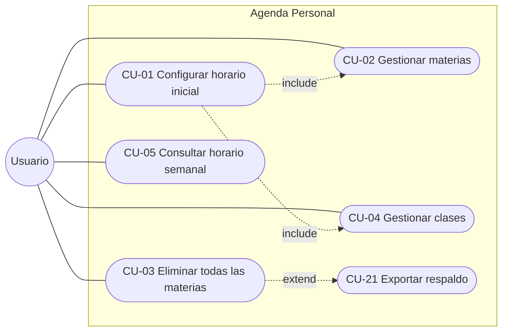
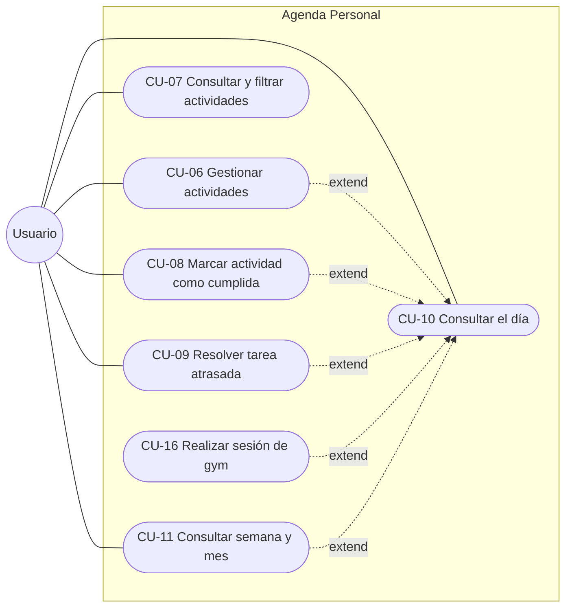
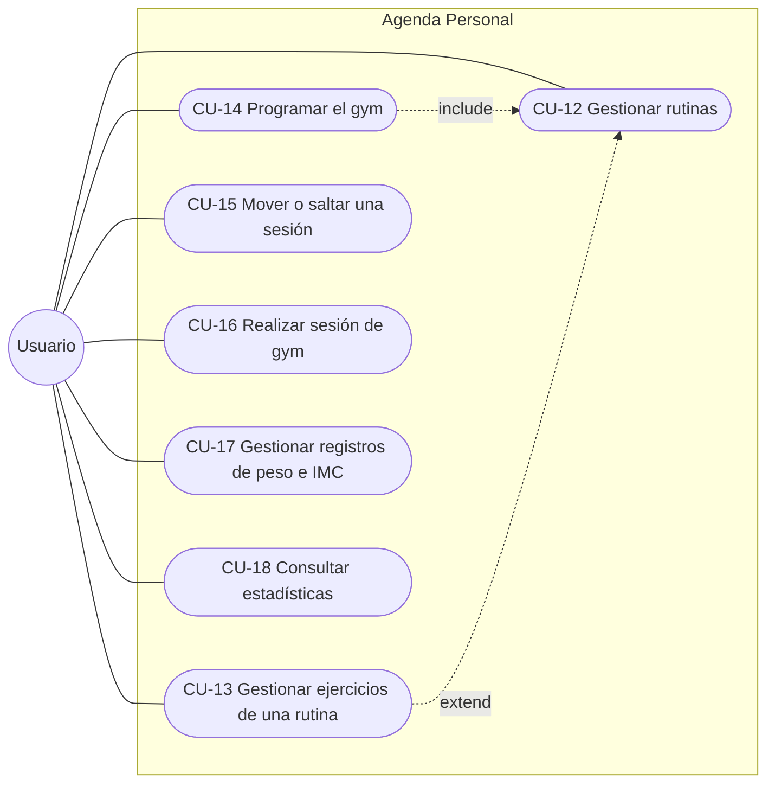
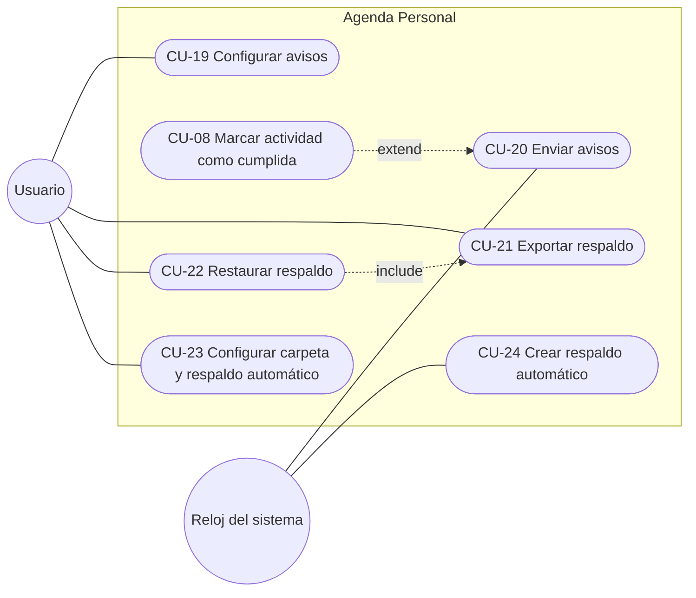

# Casos de uso

Estado: en revisión · Base: [Requerimientos v2.1](00-requerimientos.md)

---

## 1. Actores

| Actor | Tipo | Descripción |
|---|---|---|
| **Usuario** | Principal | El dueño del celular. Registra su horario, sus actividades y su gym, y consulta su agenda. |
| **Reloj del sistema** | Secundario | El tiempo como disparador. Inicia los casos que ocurren solos a una hora dada: los avisos y el respaldo automático. |

---

## 2. Diagramas de casos de uso

Un diagrama por módulo, para que cada uno se lea con claridad. Las flechas punteadas marcan las relaciones `include` (el caso siempre usa al otro) y `extend` (el caso puede llevar al otro).

### 2.1 Materias y horario académico

### 2.2 Actividades, módulo del día y vistas

### 2.3 Gym

### 2.4 Notificaciones y respaldo

---

## 3. Lista de casos de uso

Son 24 casos de uso que cubren los 47 RF. Las altas, consultas, ediciones y bajas de una misma entidad van juntas en un caso "Gestionar".

| ID | Caso de uso | Actor | RF | Incremento |
|---|---|---|---|---|
| CU-01 | Configurar horario inicial | Usuario | RF-01 | 1 |
| CU-02 | Gestionar materias | Usuario | RF-02, RF-03 | 1 |
| CU-03 | Eliminar todas las materias | Usuario | RF-04 | 1 |
| CU-04 | Gestionar clases | Usuario | RF-05, RF-07, RF-08 | 1 |
| CU-05 | Consultar horario semanal | Usuario | RF-06, RF-16 | 1 y 2 |
| CU-06 | Gestionar actividades | Usuario | RF-09, RF-11, RF-12, RF-21 | 2 |
| CU-07 | Consultar y filtrar actividades | Usuario | RF-10 | 2 |
| CU-08 | Marcar actividad como cumplida | Usuario | RF-13, RF-20, RF-43 | 2 |
| CU-09 | Resolver tarea atrasada | Usuario | RF-14 | 2 |
| CU-10 | Consultar el día | Usuario | RF-15, RF-17, RF-18, RF-19, RF-22 | 1 y 2 |
| CU-11 | Consultar semana y mes | Usuario | RF-34, RF-35, RF-36, RF-37 | 4 |
| CU-12 | Gestionar rutinas | Usuario | RF-25 | 5 |
| CU-13 | Gestionar ejercicios de una rutina | Usuario | RF-26 | 5 |
| CU-14 | Programar el gym | Usuario | RF-23 | 5 |
| CU-15 | Mover o saltar una sesión | Usuario | RF-24 | 5 |
| CU-16 | Realizar sesión de gym | Usuario | RF-27, RF-28, RF-29, RF-30, RF-31 | 5 |
| CU-17 | Gestionar registros de peso e IMC | Usuario | RF-32 | 6 |
| CU-18 | Consultar estadísticas | Usuario | RF-33 | 6 |
| CU-19 | Configurar avisos | Usuario | RF-38, RF-39, RF-41, RF-43 | 2 |
| CU-20 | Enviar avisos | Reloj del sistema | RF-38, RF-39, RF-40, RF-41, RF-42, RF-43 | 2 y 5 |
| CU-21 | Exportar respaldo | Usuario | RF-44 | 3 |
| CU-22 | Restaurar respaldo | Usuario | RF-45 | 3 |
| CU-23 | Configurar carpeta y respaldo automático | Usuario | RF-46, RF-47 | 3 |
| CU-24 | Crear respaldo automático | Reloj del sistema | RF-46 | 3 |

---

## 4. Especificación de casos de uso

Cada caso sigue esta plantilla:

| Campo | Contenido |
|---|---|
| **ID y nombre** | |
| **Actor** | |
| **Requerimientos** | |
| **Descripción** | |
| **Precondiciones** | |
| **Flujo normal** | |
| **Flujos alternativos** | |
| **Postcondiciones** | |

Los flujos alternativos se numeran con el paso del flujo normal donde empiezan: "3a" sale del paso 3. Cuando un caso se reparte entre incrementos, una nota indica qué parte llega después.

### 4.1 Materias y horario académico

#### CU-01 · Configurar horario inicial

| Campo | Contenido |
|---|---|
| **ID y nombre** | CU-01 · Configurar horario inicial |
| **Actor** | Usuario |
| **Requerimientos** | RF-01 |
| **Descripción** | La primera vez que se abre la app, o cuando no quedan materias, el sistema guía al usuario para registrar sus materias y sus clases. |
| **Precondiciones** | No hay materias registradas. |
| **Flujo normal** | 1. El usuario abre la app. 2. El sistema detecta que no hay materias y pregunta "¿Es la primera vez que usas la app?", con dos opciones: "Empezar desde cero" y "Restaurar mis datos". El usuario elige "Empezar desde cero" y el sistema muestra la guía para registrar el horario. 3. El usuario registra una materia (CU-02). 4. El usuario registra las clases de esa materia (CU-04). 5. Se repiten los pasos 3 y 4 por cada materia. 6. El usuario indica que terminó. 7. El sistema abre el módulo del día actual (CU-10). |
| **Flujos alternativos** | 2a. **Reinstalación:** el usuario elige "Restaurar mis datos". El sistema abre directamente el selector de carpetas para registrar la carpeta de respaldos (CU-23) y, al elegirla, muestra sus respaldos para restaurar uno (CU-22). Al terminar, abre el módulo del día. La pregunta inicial salió de las pruebas del incremento 3: el enlace al pie de la guía no se reconocía como botón. 3a. El usuario omite la guía: el sistema abre el módulo del día vacío. La guía vuelve a aparecer al abrir la app mientras no haya materias. 4a. El usuario no registra clases para una materia: se permite, y la materia queda sin clases. 7a. El celular es Xiaomi con MIUI: antes de abrir el módulo del día, el sistema muestra una vez la guía de MIUI para activar el inicio automático y quitar las restricciones de batería. |
| **Postcondiciones** | Hay al menos una materia registrada, y la app abre en el módulo del día. |

#### CU-02 · Gestionar materias

| Campo | Contenido |
|---|---|
| **ID y nombre** | CU-02 · Gestionar materias |
| **Actor** | Usuario |
| **Requerimientos** | RF-02, RF-03 |
| **Descripción** | El usuario registra, edita y elimina materias, cada una con nombre y color. |
| **Precondiciones** | Ninguna. |
| **Flujo normal** | 1. El usuario abre la lista de materias. 2. El sistema muestra las materias con su nombre y su color. 3. El usuario elige agregar una materia. 4. El sistema pide el nombre y el color. 5. El usuario los ingresa y guarda. 6. El sistema valida los datos, guarda la materia y la muestra en la lista. |
| **Flujos alternativos** | 3a. **Editar:** el usuario elige una materia, cambia su nombre o su color y guarda. El cambio se ve en sus clases y actividades. 3b. **Eliminar:** el usuario elige eliminar una materia. El sistema pide confirmación e indica cuántas clases se borrarán. Al confirmar, elimina la materia y sus clases, y sus actividades se conservan sin materia. 5a. El nombre está vacío: el sistema indica que es obligatorio y no guarda. 5b. Ya existe una materia con ese nombre: el sistema lo indica y no guarda. |
| **Postcondiciones** | La lista de materias refleja el cambio. |

#### CU-03 · Eliminar todas las materias

| Campo | Contenido |
|---|---|
| **ID y nombre** | CU-03 · Eliminar todas las materias |
| **Actor** | Usuario |
| **Requerimientos** | RF-04 |
| **Descripción** | Al terminar el semestre, el usuario borra de una vez todas las materias y sus clases, sin perder sus actividades. |
| **Precondiciones** | Hay al menos una materia registrada. |
| **Flujo normal** | 1. El usuario elige "Eliminar todas las materias". 2. El sistema ofrece crear un respaldo antes de borrar. 3. El usuario acepta y se crea el respaldo (CU-21). 4. El sistema pide confirmación e indica cuántas materias y clases se borrarán. 5. El usuario confirma. 6. El sistema elimina todas las materias y clases. Las actividades se conservan sin materia. |
| **Flujos alternativos** | 3a. El usuario no quiere respaldo: se pasa al paso 4. 3b. El respaldo falla o se cancela: el sistema lo indica y pregunta si sigue sin respaldo. 5a. El usuario cancela: no se borra nada. |
| **Postcondiciones** | No hay materias ni clases. La próxima vez que se abra la app aparece la guía de CU-01. |

> **Incremento 1:** los pasos 2 y 3 se omiten hasta que exista el respaldo, en el incremento 3.

#### CU-04 · Gestionar clases

| Campo | Contenido |
|---|---|
| **ID y nombre** | CU-04 · Gestionar clases |
| **Actor** | Usuario |
| **Requerimientos** | RF-05, RF-07, RF-08 |
| **Descripción** | El usuario registra, edita y elimina las clases de su horario. Cada clase se repite cada semana hasta que se elimina. |
| **Precondiciones** | Hay al menos una materia registrada. |
| **Flujo normal** | 1. El usuario elige agregar una clase, desde el horario o desde una materia. 2. El sistema pide la materia, el día de la semana, la hora de inicio, la hora de fin y el aula, que es opcional. Si se entra desde una materia, esta ya viene puesta. 3. El usuario ingresa los datos y guarda. 4. El sistema valida los datos y guarda la clase. La clase se repite cada semana, sin fecha de fin, y aparece en el módulo del día y en las vistas de semana y mes. |
| **Flujos alternativos** | 1a. No hay materias: el sistema pide registrar una primero (CU-02). 1b. **Editar:** el usuario elige una clase, cambia sus datos y guarda. El cambio se aplica a todas las semanas. 1c. **Eliminar:** el usuario elige eliminar una clase y confirma. La clase deja de aparecer en todas las semanas. 3a. La hora de fin no es posterior a la de inicio: el sistema lo indica y no guarda. 3b. La clase se cruza con otra el mismo día: el sistema advierte del cruce y guarda solo si el usuario confirma. |
| **Postcondiciones** | El horario semanal refleja el cambio. |

#### CU-05 · Consultar horario semanal

| Campo | Contenido |
|---|---|
| **ID y nombre** | CU-05 · Consultar horario semanal |
| **Actor** | Usuario |
| **Requerimientos** | RF-06, RF-16 |
| **Descripción** | El usuario ve su horario académico completo y el detalle de cada clase, con las próximas actividades de su materia. |
| **Precondiciones** | Ninguna. |
| **Flujo normal** | 1. El usuario abre el horario. 2. El sistema muestra las clases de lunes a domingo, ordenadas por hora, con el nombre y el color de su materia y el aula. 3. El usuario toca una clase. 4. El sistema muestra su detalle: materia, día, horas, aula y las próximas actividades de su materia. |
| **Flujos alternativos** | 2a. No hay clases: el sistema lo indica y ofrece agregar una (CU-04). 4a. La materia no tiene actividades próximas: el sistema lo indica. 4b. Desde el detalle, el usuario elige editar o eliminar la clase (CU-04). |
| **Postcondiciones** | No cambia ningún dato. |

> **Incremento 1:** el detalle muestra la clase sin actividades. Las próximas actividades (RF-16) llegan en el incremento 2.

### 4.2 Actividades, módulo del día y vistas

#### CU-06 · Gestionar actividades

| Campo | Contenido |
|---|---|
| **ID y nombre** | CU-06 · Gestionar actividades |
| **Actor** | Usuario |
| **Requerimientos** | RF-09, RF-11, RF-12, RF-21 |
| **Descripción** | El usuario crea, edita y elimina actividades: tareas, charlas, simulacros y exámenes. |
| **Precondiciones** | Ninguna. |
| **Flujo normal** | 1. El usuario elige agregar una actividad. 2. El sistema muestra el formulario: título, tipo (tarea, charla, simulacro o examen), fecha, hora opcional, materia opcional, notas y aviso opcional. 3. El usuario llena los datos y guarda. 4. El sistema valida los datos, guarda la actividad sin check y programa su aviso si lo tiene. |
| **Flujos alternativos** | 1a. El usuario agrega la actividad desde el módulo del día: la fecha de ese día ya viene puesta. 1b. **Editar:** el usuario abre una actividad, cambia sus datos y guarda. El sistema reprograma su aviso. 1c. **Eliminar:** el usuario elige eliminar una actividad y confirma. El sistema la borra y cancela su aviso. 2a. El tipo gym no se ofrece: esas actividades se generan desde la programación (CU-14). 3a. Falta el título o la fecha: el sistema indica qué falta y no guarda. |
| **Postcondiciones** | La actividad queda guardada, cambiada o borrada, y sus avisos quedan al día. |

#### CU-07 · Consultar y filtrar actividades

| Campo | Contenido |
|---|---|
| **ID y nombre** | CU-07 · Consultar y filtrar actividades |
| **Actor** | Usuario |
| **Requerimientos** | RF-10 |
| **Descripción** | El usuario ve la lista de actividades y la filtra por tipo y por materia. |
| **Precondiciones** | Ninguna. |
| **Flujo normal** | 1. El usuario abre la lista de actividades. 2. El sistema muestra las actividades ordenadas por fecha y hora, con su tipo, su materia y si tienen check. 3. El usuario elige un filtro por tipo, por materia o ambos. 4. El sistema muestra solo las actividades que coinciden. 5. El usuario toca una actividad y el sistema abre su detalle. |
| **Flujos alternativos** | 2a. No hay actividades: el sistema lo indica y ofrece agregar una (CU-06). 4a. Ninguna actividad coincide: el sistema lo indica y ofrece quitar los filtros. |
| **Postcondiciones** | No cambia ningún dato. |

#### CU-08 · Marcar actividad como cumplida

| Campo | Contenido |
|---|---|
| **ID y nombre** | CU-08 · Marcar actividad como cumplida |
| **Actor** | Usuario |
| **Requerimientos** | RF-13, RF-20, RF-43 |
| **Descripción** | El usuario marca una actividad como cumplida con un solo toque, o la desmarca. |
| **Precondiciones** | La actividad existe y no es de gym. |
| **Flujo normal** | 1. El usuario toca el check de una actividad, en el módulo del día o en la lista. 2. El sistema la marca como cumplida, la muestra así y cancela sus avisos pendientes. |
| **Flujos alternativos** | 1a. El usuario marca desde la notificación: toca "Marcar como cumplida" y el sistema la marca y cierra la notificación. 1b. La actividad ya estaba cumplida: el sistema la desmarca y vuelve a programar sus avisos futuros. 2a. Era una tarea atrasada: sale de la sección de atrasadas. |
| **Postcondiciones** | La actividad queda cumplida o pendiente, y sus avisos quedan al día. |

> Las actividades de gym no llevan check: quedan como realizadas al guardar su sesión (CU-16).

#### CU-09 · Resolver tarea atrasada

| Campo | Contenido |
|---|---|
| **ID y nombre** | CU-09 · Resolver tarea atrasada |
| **Actor** | Usuario |
| **Requerimientos** | RF-14 |
| **Descripción** | Desde la sección de atrasadas del módulo de hoy, el usuario marca, reprograma o borra una tarea que pasó su fecha sin check. |
| **Precondiciones** | Hay al menos una tarea con fecha pasada y sin check. |
| **Flujo normal** | 1. El usuario abre el módulo de hoy. 2. El sistema muestra la sección "Atrasadas" con cada tarea y los días que lleva de atraso. 3. El usuario elige reprogramar una tarea. 4. El sistema pide la nueva fecha. 5. El usuario elige hoy o una fecha futura. 6. El sistema cambia la fecha, quita la tarea de atrasadas y reprograma su aviso. |
| **Flujos alternativos** | 3a. **Marcar:** el usuario toca el check (CU-08) y la tarea sale de atrasadas. 3b. **Borrar:** el usuario elige borrar la tarea y confirma. El sistema la elimina. 5a. El usuario cancela: la tarea sigue atrasada. |
| **Postcondiciones** | La tarea queda cumplida, con nueva fecha o borrada, y ya no aparece como atrasada. |

#### CU-10 · Consultar el día

| Campo | Contenido |
|---|---|
| **ID y nombre** | CU-10 · Consultar el día |
| **Actor** | Usuario |
| **Requerimientos** | RF-15, RF-17, RF-18, RF-19, RF-22 |
| **Descripción** | El usuario ve el módulo del día con sus clases y actividades en orden de hora. Es la pantalla principal de la app. |
| **Precondiciones** | Ninguna. |
| **Flujo normal** | 1. El usuario abre la app. 2. El sistema muestra el módulo del día actual: primero las tareas atrasadas, en su sección destacada, y luego las clases y actividades ordenadas por hora, con el nombre y el color de su materia. Las actividades sin hora van en un grupo aparte. 3. El usuario pasa al día anterior o al siguiente, o elige una fecha. 4. El sistema muestra el módulo de ese día. 5. El usuario toca una actividad. 6. El sistema abre su detalle. |
| **Flujos alternativos** | 2a. El día no tiene nada programado: el sistema lo indica y ofrece agregar una actividad (CU-06). 4a. Es un día pasado: los exámenes, simulacros y charlas sin check se ven en su fecha como no marcados y no pasan a hoy. La sección de atrasadas solo aparece en el día actual. 6a. La actividad es de gym: el sistema abre su rutina para iniciar la sesión (CU-16). Desde el módulo, el usuario también puede agregar una actividad (CU-06), marcarla (CU-08), resolver una atrasada (CU-09) o ir a la semana y el mes (CU-11). |
| **Postcondiciones** | No cambia ningún dato. |

> **Incremento 1:** el módulo muestra solo las clases. Las actividades llegan en el incremento 2, y el flujo 6a en el incremento 5.

#### CU-11 · Consultar semana y mes

| Campo | Contenido |
|---|---|
| **ID y nombre** | CU-11 · Consultar semana y mes |
| **Actor** | Usuario |
| **Requerimientos** | RF-34, RF-35, RF-36, RF-37 |
| **Descripción** | El usuario ve su planificación a nivel macro y baja del mes a la semana y de la semana al día. |
| **Precondiciones** | Ninguna. |
| **Flujo normal** | 1. El usuario abre la vista de semana. 2. El sistema muestra los 7 días con sus clases y actividades. Los días pasados con actividades sin check llevan una señal discreta. 3. El usuario pasa a la semana anterior o a la siguiente. 4. El usuario toca un día. 5. El sistema abre el módulo de ese día (CU-10). |
| **Flujos alternativos** | 1a. **Mes:** el usuario abre la vista de mes. El sistema muestra cada día con un resumen de lo programado y la misma señal en los días pasados con actividades sin check. Al tocar un día, abre la semana que lo contiene (paso 2). |
| **Postcondiciones** | No cambia ningún dato. |

### 4.3 Gym

#### CU-12 · Gestionar rutinas

| Campo | Contenido |
|---|---|
| **ID y nombre** | CU-12 · Gestionar rutinas |
| **Actor** | Usuario |
| **Requerimientos** | RF-25 |
| **Descripción** | El usuario registra, consulta, edita y elimina sus rutinas. Los ejercicios de cada rutina se gestionan en CU-13. |
| **Precondiciones** | Ninguna. |
| **Flujo normal** | 1. El usuario abre la lista de rutinas. 2. El sistema muestra las rutinas con su nombre y cuántos ejercicios tienen. 3. El usuario elige agregar una rutina. 4. El sistema pide el nombre y el descanso entre ejercicios por defecto, que es opcional. 5. El usuario los ingresa y guarda. 6. El sistema valida los datos, guarda la rutina y abre su detalle. 7. El usuario agrega los ejercicios de la rutina (CU-13). |
| **Flujos alternativos** | 2a. **Consultar:** el usuario toca una rutina y el sistema muestra su detalle con sus ejercicios en orden. Desde ahí gestiona los ejercicios (CU-13). 3a. **Editar:** el usuario cambia el nombre o el descanso entre ejercicios de una rutina y guarda. Los cambios valen para las sesiones futuras, y las sesiones guardadas conservan sus series. 3b. **Eliminar:** el usuario elige eliminar una rutina y confirma. Si la rutina está asignada a un día de la programación, el sistema indica qué días la usan y pide asignarles otra rutina antes de eliminarla. 6a. Falta el nombre: el sistema lo indica y no guarda. 6b. Ya existe una rutina con ese nombre: el sistema lo indica y no guarda. |
| **Postcondiciones** | La lista de rutinas refleja el cambio. |

> Una rutina sin ejercicios se puede guardar, pero no se puede asignar a un día de gym (CU-14) ni iniciar una sesión con ella (CU-16).

#### CU-13 · Gestionar ejercicios de una rutina

| Campo | Contenido |
|---|---|
| **ID y nombre** | CU-13 · Gestionar ejercicios de una rutina |
| **Actor** | Usuario |
| **Requerimientos** | RF-26 |
| **Descripción** | Desde el detalle de una rutina, el usuario agrega, consulta, edita, elimina y reordena sus ejercicios, uno por uno. |
| **Precondiciones** | La rutina existe y el usuario está en su detalle. |
| **Flujo normal** | 1. El sistema muestra los ejercicios de la rutina en orden, cada uno con su nombre, sus series y sus repeticiones o duración. 2. El usuario elige agregar un ejercicio. 3. El sistema muestra el formulario: nombre, forma de medirse (repeticiones o tiempo), series, repeticiones o duración, y de forma opcional peso, descanso entre series, descanso tras el ejercicio y nota. 4. El usuario llena los datos y guarda. 5. El sistema valida los datos y agrega el ejercicio al final de la lista. |
| **Flujos alternativos** | 1a. La rutina no tiene ejercicios: el sistema lo indica y ofrece agregar el primero. 2a. **Consultar:** el usuario toca un ejercicio y el sistema muestra todos sus datos. 2b. **Editar:** el usuario abre un ejercicio, cambia sus datos y guarda. El cambio vale para las sesiones futuras, y las sesiones guardadas conservan sus series. 2c. **Eliminar:** el usuario elige eliminar un ejercicio y confirma. El ejercicio sale de la rutina, y las sesiones guardadas conservan sus series. 2d. **Reordenar:** cada ejercicio es un bloque. El usuario lo mantiene presionado y lo arrastra a cualquier posición de la lista, o elige "Mover a la posición…" en su menú e indica el número. El sistema lo coloca en esa posición, corre los demás, renumera la lista y guarda el nuevo orden. Durante unos segundos ofrece "Deshacer". 2e. **Duplicar:** el usuario duplica un ejercicio. El sistema crea una copia debajo del original y abre su formulario para cambiar lo necesario. 3a. El usuario elige la forma de medirse: con repeticiones, el formulario pide repeticiones; con tiempo, pide la duración. 4a. El usuario elige "Guardar y agregar otro": el sistema guarda el ejercicio y deja el formulario vacío para el siguiente, sin volver a la lista. 4b. El usuario cancela: no se agrega nada. 5a. Falta el nombre, las series o las repeticiones o la duración, o alguno no es mayor que cero: el sistema indica qué falta y no guarda. |
| **Postcondiciones** | La lista de ejercicios de la rutina refleja el cambio. |

#### CU-14 · Programar el gym

| Campo | Contenido |
|---|---|
| **ID y nombre** | CU-14 · Programar el gym |
| **Actor** | Usuario |
| **Requerimientos** | RF-23 |
| **Descripción** | El usuario elige los días de la semana en que entrena, con la hora y la rutina de cada día. La programación se repite cada semana. |
| **Precondiciones** | Hay al menos una rutina con ejercicios. |
| **Flujo normal** | 1. El usuario abre la programación del gym. 2. El sistema muestra los días de la semana con su hora y su rutina, si los tienen. 3. El usuario elige los días en que entrena. 4. Para cada día, el usuario elige la hora y la rutina. 5. El usuario pone una fecha de fin, si quiere, y guarda. 6. El sistema guarda la programación, genera las actividades de gym de las próximas semanas y programa sus avisos. |
| **Flujos alternativos** | 1a. No hay rutinas con ejercicios: el sistema pide crear una primero (CU-12 y CU-13). 4a. Al elegir la rutina, solo se ofrecen las que tienen ejercicios. 5a. Un día elegido no tiene hora o rutina: el sistema lo indica y no guarda. 6a. Se cambia una programación que ya existía: el sistema regenera las actividades futuras no realizadas. Las sesiones pasadas no cambian, y las sesiones movidas o saltadas (CU-15) se conservan. 6b. Hay fecha de fin: no se generan actividades después de esa fecha. |
| **Postcondiciones** | Las actividades de gym aparecen en el módulo del día y en las vistas de semana y mes. |

#### CU-15 · Mover o saltar una sesión

| Campo | Contenido |
|---|---|
| **ID y nombre** | CU-15 · Mover o saltar una sesión |
| **Actor** | Usuario |
| **Requerimientos** | RF-24 |
| **Descripción** | El usuario cambia la fecha u hora de una sesión puntual, o la salta, sin tocar la programación semanal. |
| **Precondiciones** | La actividad de gym es de hoy o de un día futuro y no se ha realizado. |
| **Flujo normal** | 1. El usuario abre una actividad de gym. 2. El usuario elige moverla. 3. El sistema pide la nueva fecha y hora. 4. El usuario las elige y guarda. 5. El sistema mueve solo esa actividad y reprograma su aviso. La programación semanal no cambia. |
| **Flujos alternativos** | 2a. **Saltar:** el usuario elige saltar la sesión y confirma. La actividad queda como saltada y su aviso se cancela. 4a. El usuario cancela: no cambia nada. |
| **Postcondiciones** | Solo cambia esa sesión. Las demás semanas siguen la programación. |

#### CU-16 · Realizar sesión de gym

| Campo | Contenido |
|---|---|
| **ID y nombre** | CU-16 · Realizar sesión de gym |
| **Actor** | Usuario |
| **Requerimientos** | RF-27, RF-28, RF-29, RF-30, RF-31 |
| **Descripción** | El usuario hace su rutina guiado por el cronómetro, el contador de series y los descansos, y el sistema guarda la sesión. |
| **Precondiciones** | Hay una actividad de gym con rutina y sin sesión guardada. |
| **Flujo normal** | 1. El usuario toca una actividad de gym en el módulo del día. 2. El sistema muestra la rutina con sus ejercicios. 3. El usuario inicia la sesión. 4. El sistema guarda la hora de inicio, arranca el cronómetro y muestra una notificación fija con el cronómetro. 5. El sistema muestra el primer ejercicio con "Serie 1 de N". La serie viene rellenada con lo que se hizo la última vez o, si no hay registro, con lo de la rutina. 6. El usuario confirma la serie con un toque. 7. El sistema guarda la serie e inicia el descanso entre series, que también se ve en la notificación. 8. Al terminar el descanso, el sistema avisa con vibración o sonido y muestra la serie siguiente. 9. Se repiten los pasos 6 a 8 hasta la última serie. Al confirmarla, el sistema inicia el descanso entre ejercicios y pasa al siguiente ejercicio. 10. Tras el último ejercicio, el usuario termina la sesión. 11. El sistema guarda la sesión con su fecha, hora de inicio, duración, rutina y series realizadas, marca la actividad como realizada y quita la notificación. |
| **Flujos alternativos** | 4a. La app pasa a segundo plano o se cierra: el cronómetro se calcula desde la hora de inicio guardada y la notificación sigue activa. Al volver, el sistema retoma la sesión donde iba. 5a. El ejercicio es por tiempo: el usuario inicia la cuenta regresiva, el sistema avisa al terminar y el usuario confirma la serie. 6a. El usuario corrige las repeticiones, el tiempo o el peso antes de confirmar. 7a. No hay descanso configurado: el sistema pasa directo a la serie siguiente. 7b. El usuario alarga o acorta el descanso 15 segundos, o lo salta. 9a. El descanso tras el ejercicio está configurado en el ejercicio: reemplaza al de la rutina. Si ninguno está configurado, se pasa directo al siguiente ejercicio. 9b. **Cambiar el orden:** en cualquier momento, el usuario abre la lista de ejercicios de la sesión. Puede arrastrar cualquier ejercicio pendiente, como un bloque, a cualquier posición entre los pendientes, usar "Mover a la posición…" o elegir "Hacer ahora" en uno de ellos para que sea el actual. El sistema actualiza cuál es el siguiente. Las series ya hechas no cambian, y si el ejercicio actual tenía series hechas, vuelve a pendientes con las que le faltan. 10a. El usuario termina antes de completar la rutina: el sistema pide confirmación y guarda las series hechas. 10b. El usuario descarta la sesión: el sistema pide confirmación y no guarda nada. 11a. El orden de la sesión fue distinto al de la rutina: al guardar, el sistema pregunta "¿Guardar este orden en la rutina?". Si el usuario acepta, actualiza el orden de los ejercicios de la rutina (CU-13). Si no, la rutina queda como estaba. |
| **Postcondiciones** | La sesión queda guardada y la actividad aparece como realizada. |

> Si el día de una actividad de gym termina sin sesión, el sistema la deja como no realizada.

#### CU-17 · Gestionar registros de peso e IMC

| Campo | Contenido |
|---|---|
| **ID y nombre** | CU-17 · Gestionar registros de peso e IMC |
| **Actor** | Usuario |
| **Requerimientos** | RF-32 |
| **Descripción** | El usuario registra su peso corporal con fecha, y consulta, edita o elimina esos registros. Con su estatura, el sistema calcula el IMC de cada registro. |
| **Precondiciones** | Ninguna. |
| **Flujo normal** | 1. El usuario abre los registros de peso. 2. El sistema muestra el IMC actual con su categoría, y los registros ordenados por fecha, del más reciente al más antiguo, cada uno con su peso y su IMC. 3. El usuario elige agregar un registro. 4. El sistema pide el peso y la fecha, con hoy puesto por defecto. 5. El usuario ingresa el peso y guarda. 6. El sistema valida el peso, guarda el registro y calcula su IMC: peso en kg dividido entre la estatura en metros al cuadrado. |
| **Flujos alternativos** | 1a. No hay estatura registrada: el sistema la pide en centímetros. Si el usuario no la ingresa, los registros se muestran sin IMC. 2a. **Cambiar estatura:** el usuario edita su estatura. El sistema recalcula el IMC de todos los registros. 3a. **Editar:** el usuario elige un registro, cambia el peso o la fecha y guarda. El sistema recalcula su IMC. 3b. **Eliminar:** el usuario elige eliminar un registro y confirma. 6a. El peso está vacío o no es mayor que cero: el sistema lo indica y no guarda. 6b. Ya hay un registro en esa fecha: el sistema ofrece reemplazarlo. |
| **Postcondiciones** | La lista de registros refleja el cambio, con el IMC al día. |

> El IMC se clasifica con las categorías de la OMS para adultos: bajo peso (menos de 18.5), normal (18.5 a 24.9), sobrepeso (25 a 29.9) y obesidad (30 o más). Es un dato orientativo y no reemplaza una evaluación médica.

#### CU-18 · Consultar estadísticas

| Campo | Contenido |
|---|---|
| **ID y nombre** | CU-18 · Consultar estadísticas |
| **Actor** | Usuario |
| **Requerimientos** | RF-33 |
| **Descripción** | El usuario ve gráficas de su entrenamiento y de su peso en el periodo que elija. |
| **Precondiciones** | Ninguna. |
| **Flujo normal** | 1. El usuario abre las estadísticas. 2. El sistema muestra las gráficas del último mes: minutos entrenados por semana y por mes, sesiones hechas frente a planificadas, evolución del peso corporal y del IMC, y progreso de fuerza. 3. El usuario cambia el periodo: semana, mes, 3 meses o todo el historial. 4. El sistema actualiza las gráficas. 5. El usuario elige un ejercicio. 6. El sistema muestra su peso máximo y su volumen en el periodo. |
| **Flujos alternativos** | 2a. No hay datos en el periodo: el sistema lo indica en cada gráfica vacía. |
| **Postcondiciones** | No cambia ningún dato. |

### 4.4 Notificaciones y respaldo

#### CU-19 · Configurar avisos

| Campo | Contenido |
|---|---|
| **ID y nombre** | CU-19 · Configurar avisos |
| **Actor** | Usuario |
| **Requerimientos** | RF-38, RF-39, RF-41, RF-43 |
| **Descripción** | El usuario activa o desactiva cada tipo de aviso y ajusta sus horas y anticipaciones. |
| **Precondiciones** | Ninguna. |
| **Flujo normal** | 1. El usuario abre los ajustes de avisos. 2. El sistema muestra cada tipo de aviso con su estado y su configuración: actividades (hora fija para las que no tienen hora), día anterior de exámenes y simulacros (hora), gym (minutos antes), clases (minutos antes, desactivado por defecto) y resumen del día (hora). También muestra "Avisos con prioridad de alarma", activado por defecto. 3. El usuario activa o desactiva un tipo, o cambia su configuración. 4. El sistema guarda el cambio y reprograma los avisos afectados. |
| **Flujos alternativos** | 1a. En Android 13 o superior, la app no tiene permiso de notificaciones: el sistema lo pide. Si el usuario lo niega, el sistema indica que los avisos no llegarán y cómo activarlo después. 1b. La app no tiene permiso de alarmas exactas: el sistema lo pide y abre el ajuste de Android. 1c. El celular es Xiaomi con MIUI: el sistema muestra la guía de MIUI con el estado de la batería y las notificaciones, y los pasos para activar el inicio automático y bloquear la app en recientes. Cada paso tiene un botón que abre el ajuste que corresponde. |
| **Postcondiciones** | Los avisos programados siguen la nueva configuración. |

#### CU-20 · Enviar avisos

| Campo | Contenido |
|---|---|
| **ID y nombre** | CU-20 · Enviar avisos |
| **Actor** | Reloj del sistema |
| **Requerimientos** | RF-38, RF-39, RF-40, RF-41, RF-42, RF-43 |
| **Descripción** | A la hora programada, el sistema muestra el aviso que corresponde: de actividad, de día anterior, de gym, de clase o el resumen del día. |
| **Precondiciones** | Hay un aviso programado y su tipo está activado. |
| **Flujo normal** | 1. Llega la hora de un aviso de actividad, según la anticipación que eligió el usuario. 2. El sistema comprueba que el tipo de aviso sigue activado y que la actividad sigue sin check. 3. El sistema muestra la notificación con el título, la hora y la materia de la actividad, y un botón "Marcar como cumplida". |
| **Flujos alternativos** | 1a. La actividad no tiene hora: el aviso llega a la hora fija configurada. 1b. Es un examen o simulacro: llega también un aviso el día anterior, a la hora configurada. 1c. Es una actividad de gym: el aviso llega unos minutos antes, con el nombre de la rutina. 1d. Es una clase: el aviso llega unos minutos antes, solo si los avisos de clase están activados. 1e. Es la hora del resumen: el sistema muestra las actividades del día y las tareas atrasadas. Si no hay nada, no envía el resumen. 1f. El celular se reinicia: al encender, el sistema vuelve a programar todos los avisos pendientes. 2a. La actividad ya está cumplida o el tipo está desactivado: no se muestra nada. 3a. El usuario toca "Marcar como cumplida" (CU-08). 3b. El usuario toca la notificación: el sistema abre el detalle de la actividad. |
| **Postcondiciones** | El aviso se mostró o se descartó. |

> **Incremento 2:** cubre los avisos de actividad, de día anterior, de clase y el resumen. El aviso de gym (1c) llega en el incremento 5.

#### CU-21 · Exportar respaldo

| Campo | Contenido |
|---|---|
| **ID y nombre** | CU-21 · Exportar respaldo |
| **Actor** | Usuario |
| **Requerimientos** | RF-44 |
| **Descripción** | Con un toque, el usuario guarda todos los datos de la app en un archivo dentro de la carpeta de respaldos. |
| **Precondiciones** | Ninguna. |
| **Flujo normal** | 1. El usuario elige "Respaldar ahora" en los ajustes. 2. El sistema comprueba que hay una carpeta de respaldos registrada y que conserva el permiso sobre ella. 3. El sistema genera un archivo JSON con todos los datos, la versión de la base de datos, la fecha y la versión de la app. 4. El sistema lo guarda en la carpeta como `agenda-manual-2026-10-31-2115.json`. 5. El sistema confirma que terminó y actualiza la fecha del último respaldo. |
| **Flujos alternativos** | 1a. **Copia en otra ubicación:** el usuario elige "Guardar una copia en otra ubicación". El sistema abre el selector de archivos de Android, el usuario elige el destino, por ejemplo Google Drive, y el sistema escribe ahí el archivo. Esta copia no reemplaza al respaldo en la carpeta. 2a. No hay carpeta registrada, o se perdió el permiso: el sistema explica para qué sirve la carpeta y pide registrarla (CU-23). Al elegirla, sigue en el paso 3. Si el usuario cancela, no se crea nada. 4a. No se puede escribir el archivo, por falta de espacio: el sistema lo indica y no cambia la fecha del último respaldo. |
| **Postcondiciones** | Hay un archivo de respaldo con todos los datos en la carpeta de respaldos. |

#### CU-22 · Restaurar respaldo

| Campo | Contenido |
|---|---|
| **ID y nombre** | CU-22 · Restaurar respaldo |
| **Actor** | Usuario |
| **Requerimientos** | RF-45 |
| **Descripción** | El usuario reemplaza los datos actuales por los de un archivo de respaldo, por ejemplo después de reinstalar la app. |
| **Precondiciones** | Ninguna. |
| **Flujo normal** | 1. El usuario elige "Restaurar respaldo" en los ajustes. 2. El sistema muestra los respaldos de la carpeta de respaldos, del más reciente al más antiguo, con su fecha y su tipo: manual, automático o de seguridad. 3. El usuario elige uno. 4. El sistema lo lee y muestra su fecha, la versión de la app y lo que contiene: cuántas materias, clases, actividades, rutinas, sesiones y registros de peso. 5. El sistema advierte que los datos actuales se reemplazarán y pide confirmación. 6. El usuario confirma. 7. El sistema crea un respaldo de seguridad de los datos actuales en la carpeta, como `agenda-seguridad-2026-10-31-2120.json`. 8. El sistema reemplaza los datos por los del archivo. Si el respaldo es de una versión anterior de la base de datos, lo adapta a la versión actual. 9. El sistema reprograma los avisos y confirma que terminó. |
| **Flujos alternativos** | 2a. No hay carpeta registrada, por ejemplo después de reinstalar la app: el sistema pide registrarla (CU-23). Si el usuario elige la misma carpeta de antes, aparecen sus respaldos. 2b. **Buscar en otra ubicación:** el usuario elige esa opción, el sistema abre el selector de archivos de Android y el usuario elige un archivo, por ejemplo en Google Drive. Sigue en el paso 4. 2c. La carpeta no tiene respaldos: el sistema lo indica y ofrece buscar en otra ubicación. 4a. El archivo no es un respaldo válido o está dañado: el sistema lo indica y no cambia nada. 4b. El respaldo es de una versión de la base de datos más nueva que la app: el sistema pide actualizar la app y no cambia nada. 6a. El usuario cancela: no cambia nada. 7a. El respaldo de seguridad falla: el sistema lo indica y no sigue. 8a. Falla la restauración: el sistema deshace los cambios y los datos actuales quedan como estaban. |
| **Postcondiciones** | La app tiene los datos del respaldo, y existe una copia de los datos anteriores. |

#### CU-23 · Configurar carpeta y respaldo automático

| Campo | Contenido |
|---|---|
| **ID y nombre** | CU-23 · Configurar carpeta y respaldo automático |
| **Actor** | Usuario |
| **Requerimientos** | RF-46, RF-47 |
| **Descripción** | El usuario registra la carpeta donde se guardan todos los respaldos, activa el respaldo automático con su frecuencia y ve cuándo fue el último respaldo. |
| **Precondiciones** | Ninguna. |
| **Flujo normal** | 1. El usuario abre los ajustes de respaldo. 2. El sistema muestra la carpeta de respaldos, la fecha del último respaldo y el estado y la frecuencia del respaldo automático. 3. El usuario elige "Elegir carpeta". 4. El sistema abre el selector de carpetas de Android y sugiere crear una carpeta `AgendaRespaldos` dentro de Documentos. 5. El usuario elige o crea la carpeta. 6. El sistema conserva el permiso sobre la carpeta para que sobreviva a reinicios y muestra su nombre. 7. El usuario activa el respaldo automático y elige la frecuencia, semanal por defecto. 8. El sistema guarda la configuración y programa el respaldo automático (CU-24). |
| **Flujos alternativos** | 1a. **Primera vez:** cuando hace falta un respaldo y no hay carpeta (CU-03, CU-21, CU-22), o al abrir la app por primera vez con el módulo de respaldo, el sistema explica para qué sirve la carpeta y lleva al paso 4. 2a. Pasó más de una semana sin respaldo: el sistema muestra una advertencia destacada. 3a. **Cambiar carpeta:** el usuario elige otra carpeta. Los respaldos anteriores se quedan en la carpeta vieja, y el sistema lo indica. 5a. El usuario cancela el selector: la carpeta no cambia. Si no había ninguna, el respaldo automático no se puede activar. 5b. Android no permite elegir esa carpeta, como la raíz del almacenamiento o Descargas: el selector lo impide, y el sistema sugiere crear una subcarpeta. 7a. El usuario desactiva el respaldo automático: el sistema cancela su programación. |
| **Postcondiciones** | Hay una carpeta de respaldos registrada, y el respaldo automático queda programado o desactivado. |

#### CU-24 · Crear respaldo automático

| Campo | Contenido |
|---|---|
| **ID y nombre** | CU-24 · Crear respaldo automático |
| **Actor** | Reloj del sistema |
| **Requerimientos** | RF-46 |
| **Descripción** | Con la frecuencia elegida, el sistema crea un respaldo en la carpeta de respaldos y conserva solo los últimos 5 automáticos. |
| **Precondiciones** | El respaldo automático está activado y hay una carpeta de respaldos registrada. |
| **Flujo normal** | 1. Llega la fecha del siguiente respaldo. 2. El sistema genera el archivo JSON igual que en CU-21. 3. El sistema lo guarda en la carpeta como `agenda-auto-2026-11-07-0300.json`. 4. Si hay más de 5 respaldos automáticos en la carpeta, el sistema borra los más antiguos. 5. El sistema actualiza la fecha del último respaldo. |
| **Flujos alternativos** | 1a. El celular estaba apagado a esa hora: el respaldo se hace en cuanto vuelve a estar disponible. 1b. El sistema del celular, por ejemplo MIUI, impidió el respaldo: al abrir la app, el sistema detecta que está atrasado según su frecuencia y lo hace en ese momento. 3a. La carpeta ya no existe o se perdió el permiso: el sistema no crea el respaldo y muestra una notificación para elegir otra carpeta (CU-23). 4a. Solo se borran los archivos `agenda-auto-`, nunca los manuales. Los de seguridad (`agenda-seguridad-`) tienen su propio límite de 5. |
| **Postcondiciones** | Hay un respaldo nuevo en la carpeta y como máximo 5 automáticos. |
