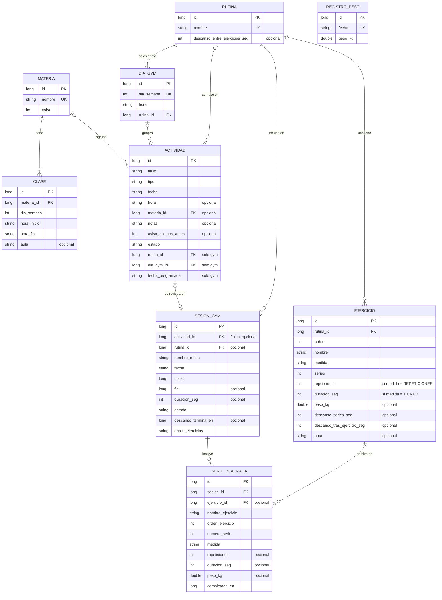

# Modelo de datos

Estado: en revisión · Base: [Requerimientos v2.1](00-requerimientos.md), [Casos de uso](01-casos-de-uso.md)

---

La base de datos es Room sobre SQLite (RNF-03). Tiene 9 tablas. Los ajustes van aparte, en DataStore.

**Criterios generales**

- **Lo que se repite no se guarda por fecha.** Las clases se guardan una vez, con su día de la semana, y se calculan para cada fecha al consultar. Las actividades de gym sí se guardan una por fecha, porque cada una puede moverse, saltarse o tener su sesión.
- **Lo que se deriva no se guarda.** El IMC, el estado "atrasada" y el estado "no realizada" se calculan al consultar. Así no hace falta un proceso que los actualice cada día.
- **El historial no depende de lo que se borra.** Las sesiones guardan una copia del nombre de la rutina y de cada ejercicio, así que borrar una rutina o un ejercicio no deja series sin nombre.
- **Los tipos son legibles en el respaldo.** Las fechas se guardan como texto ISO (`2026-10-31`) y las horas como `HH:mm`. Así se ordenan bien en SQL y se leen sin conversión en el JSON del respaldo (RNF-06).

---

## 1. Diagrama entidad-relación



`REGISTRO_PESO` no se relaciona con otras tablas. El IMC se calcula con la estatura guardada en los ajustes.

---

## 2. Entidades y campos

### 2.1 Tipos y convenciones

| Dato | Tipo en Kotlin | Columna en SQLite | Ejemplo |
|---|---|---|---|
| Identificador | `Long` | `INTEGER`, autogenerado | `12` |
| Fecha | `LocalDate` | `TEXT` ISO-8601 | `2026-10-31` |
| Hora del día | `LocalTime` | `TEXT` `HH:mm` | `07:30` |
| Instante | `Instant` | `INTEGER`, milisegundos desde 1970 | `1793462400000` |
| Duración | `Int` | `INTEGER`, segundos | `90` |
| Día de la semana | `DayOfWeek` | `INTEGER`, 1 = lunes … 7 = domingo | `3` |
| Color | `Int` | `INTEGER`, ARGB | `0xFF4F7CAC` |
| Peso | `Double` | `REAL`, kilogramos | `72.5` |
| Enumeraciones | `enum class` | `TEXT`, nombre de la constante | `EXAMEN` |

Las conversiones van en un único `TypeConverters`. `java.time` está disponible desde la API 26, así que no hace falta desugaring (RNF-01). La semana empieza el lunes.

### 2.2 Tablas

#### `materia`

| Campo | Tipo | Nulo | Descripción |
|---|---|---|---|
| `id` | Long | No | Clave primaria. |
| `nombre` | String | No | Único sin distinguir mayúsculas (`COLLATE NOCASE`). CU-02 5b. |
| `color` | Int | No | Color ARGB elegido por el usuario. |

#### `clase`

| Campo | Tipo | Nulo | Descripción |
|---|---|---|---|
| `id` | Long | No | Clave primaria. |
| `materia_id` | Long | No | Materia de la clase. |
| `dia_semana` | DayOfWeek | No | Día en que se repite cada semana. |
| `hora_inicio` | LocalTime | No | |
| `hora_fin` | LocalTime | No | Posterior a `hora_inicio`; lo valida la app. |
| `aula` | String | Sí | |

#### `actividad`

| Campo | Tipo | Nulo | Descripción |
|---|---|---|---|
| `id` | Long | No | Clave primaria. |
| `titulo` | String | No | En las de gym, el nombre de la rutina al generarse. |
| `tipo` | TipoActividad | No | `TAREA`, `CHARLA`, `SIMULACRO`, `EXAMEN` o `GYM`. |
| `fecha` | LocalDate | No | Fecha actual de la actividad. Cambia al reprogramar o mover. |
| `hora` | LocalTime | Sí | Sin hora, va al grupo "Sin hora" del módulo del día. |
| `materia_id` | Long | Sí | Nula si no tiene materia o si su materia se borró. |
| `notas` | String | Sí | |
| `aviso_minutos_antes` | Int | Sí | Nulo = sin aviso. Si no hay hora, el aviso va a la hora fija de los ajustes. |
| `estado` | EstadoActividad | No | `PENDIENTE`, `CUMPLIDA` o `SALTADA`. |
| `rutina_id` | Long | Sí | Solo gym: rutina que toca ese día. |
| `dia_gym_id` | Long | Sí | Solo gym: día de la programación que la generó. |
| `fecha_programada` | LocalDate | Sí | Solo gym: fecha en que la generó la programación. No cambia al moverla. |

Un mismo campo `estado` sirve para todos los tipos: `CUMPLIDA` es el check de una actividad normal y la sesión realizada de una de gym. `SALTADA` solo se usa en gym (CU-15).

**Estados derivados**, que no se guardan:

| Estado | Condición |
|---|---|
| Atrasada | `tipo = TAREA`, `estado = PENDIENTE` y `fecha < hoy`. |
| No marcada | `tipo` es `CHARLA`, `SIMULACRO` o `EXAMEN`, `estado = PENDIENTE` y `fecha < hoy`. |
| No realizada | `tipo = GYM`, `estado = PENDIENTE` y `fecha < hoy`. |

#### `rutina`

| Campo | Tipo | Nulo | Descripción |
|---|---|---|---|
| `id` | Long | No | Clave primaria. |
| `nombre` | String | No | Único sin distinguir mayúsculas. CU-12 6b. |
| `descanso_entre_ejercicios_seg` | Int | Sí | Descanso por defecto entre ejercicios. |

#### `ejercicio`

| Campo | Tipo | Nulo | Descripción |
|---|---|---|---|
| `id` | Long | No | Clave primaria. |
| `rutina_id` | Long | No | Rutina a la que pertenece. |
| `orden` | Int | No | Posición en la rutina, desde 0. Se reescribe al reordenar (CU-13 2d). |
| `nombre` | String | No | |
| `medida` | Medida | No | `REPETICIONES` o `TIEMPO`. |
| `series` | Int | No | Mayor que cero. |
| `repeticiones` | Int | Sí | Obligatorio si `medida = REPETICIONES`. |
| `duracion_seg` | Int | Sí | Obligatorio si `medida = TIEMPO`. |
| `peso_kg` | Double | Sí | |
| `descanso_series_seg` | Int | Sí | |
| `descanso_tras_ejercicio_seg` | Int | Sí | Si existe, reemplaza el descanso de la rutina. |
| `nota` | String | Sí | |

Room no permite restricciones `CHECK`, así que la regla entre `medida`, `repeticiones` y `duracion_seg` la valida el ViewModel antes de guardar.

#### `dia_gym`

| Campo | Tipo | Nulo | Descripción |
|---|---|---|---|
| `id` | Long | No | Clave primaria. |
| `dia_semana` | DayOfWeek | No | Único: un día de gym por día de la semana. |
| `hora` | LocalTime | No | |
| `rutina_id` | Long | No | Rutina de ese día. Debe tener ejercicios (CU-14 4a). |

La fecha de fin opcional de la programación (RF-23) se guarda en los ajustes, porque vale para todos los días.

#### `sesion_gym`

| Campo | Tipo | Nulo | Descripción |
|---|---|---|---|
| `id` | Long | No | Clave primaria. |
| `actividad_id` | Long | Sí | Actividad de gym de la sesión. Único: una sesión por actividad. |
| `rutina_id` | Long | Sí | Nula si la rutina se borró después. |
| `nombre_rutina` | String | No | Copia del nombre al iniciar la sesión. |
| `fecha` | LocalDate | No | Fecha en que se hizo. |
| `inicio` | Instant | No | El cronómetro se calcula desde aquí (RNF-07). |
| `fin` | Instant | Sí | Nulo mientras la sesión está en curso. |
| `duracion_seg` | Int | Sí | `fin - inicio`, guardada al terminar para sumar rápido en las estadísticas. |
| `estado` | EstadoSesion | No | `EN_CURSO` o `TERMINADA`. |
| `descanso_termina_en` | Instant | Sí | Fin del descanso en curso, para recuperar la cuenta regresiva si la app se cierra. |
| `orden_ejercicios` | List&lt;Long&gt; | No | Orden de los ejercicios en esta sesión, como ids separados por comas (`12,15,13,14`). Empieza igual al de la rutina y cambia si el usuario reordena durante la sesión (CU-16 9b). |

El orden de la sesión se guarda aparte del de la rutina. Así, cambiar el orden en el gym no toca la rutina, salvo que el usuario lo pida al terminar (CU-16 11a). También permite retomar la sesión en el mismo orden si la app se cierra.

Solo puede haber una sesión `EN_CURSO`. Al abrir la app, si existe, se retoma (CU-16 4a). Al descartarla (CU-16 10b) se borra con sus series.

#### `serie_realizada`

| Campo | Tipo | Nulo | Descripción |
|---|---|---|---|
| `id` | Long | No | Clave primaria. |
| `sesion_id` | Long | No | |
| `ejercicio_id` | Long | Sí | Nulo si el ejercicio se borró de la rutina. |
| `nombre_ejercicio` | String | No | Copia del nombre al hacer la serie. |
| `orden_ejercicio` | Int | No | Posición del ejercicio en la sesión. |
| `numero_serie` | Int | No | 1, 2, 3… |
| `medida` | Medida | No | |
| `repeticiones` | Int | Sí | Lo realmente hecho. |
| `duracion_seg` | Int | Sí | |
| `peso_kg` | Double | Sí | |
| `completada_en` | Instant | No | Momento en que se confirmó la serie. |

#### `registro_peso`

| Campo | Tipo | Nulo | Descripción |
|---|---|---|---|
| `id` | Long | No | Clave primaria. |
| `fecha` | LocalDate | No | Única: un registro por día (CU-17 6b). |
| `peso_kg` | Double | No | Mayor que cero. |

El IMC no se guarda: `imc = peso_kg / (estatura_cm / 100)²`. Así, al cambiar la estatura, todos los registros se actualizan solos (CU-17 2a).

### 2.3 Ajustes (DataStore)

Los ajustes no son tablas, pero entran en el respaldo.

| Grupo | Ajustes | Va en el respaldo |
|---|---|---|
| Perfil | `estatura_cm` | Sí |
| Gym | `fecha_fin_programacion` | Sí |
| Avisos | Activación de cada tipo, hora fija para actividades sin hora, hora del aviso del día anterior, minutos antes del gym, minutos antes de las clases, hora del resumen, avisos con prioridad de alarma (`setAlarmClock`, activado por defecto) | Sí |
| Respaldo automático | Activado, frecuencia | Sí |
| Carpeta de respaldos | URI de la carpeta registrada | No: el permiso sobre la carpeta es de cada instalación, y tras reinstalar se registra de nuevo |
| Estado interno | Fecha del último respaldo, hasta qué fecha se generaron las actividades de gym, hora de la última comprobación al abrir | No |

### 2.4 Ejemplo de entidad

```kotlin
@Entity(
    tableName = "actividad",
    foreignKeys = [
        ForeignKey(entity = Materia::class, parentColumns = ["id"], childColumns = ["materia_id"], onDelete = ForeignKey.SET_NULL),
        ForeignKey(entity = Rutina::class, parentColumns = ["id"], childColumns = ["rutina_id"], onDelete = ForeignKey.SET_NULL),
        ForeignKey(entity = DiaGym::class, parentColumns = ["id"], childColumns = ["dia_gym_id"], onDelete = ForeignKey.SET_NULL),
    ],
    indices = [
        Index("fecha"),
        Index("materia_id"),
        Index("rutina_id"),
        Index(value = ["dia_gym_id", "fecha_programada"], unique = true),
    ],
)
data class Actividad(
    @PrimaryKey(autoGenerate = true) val id: Long = 0,
    val titulo: String,
    val tipo: TipoActividad,
    val fecha: LocalDate,
    val hora: LocalTime? = null,
    @ColumnInfo(name = "materia_id") val materiaId: Long? = null,
    val notas: String? = null,
    @ColumnInfo(name = "aviso_minutos_antes") val avisoMinutosAntes: Int? = null,
    val estado: EstadoActividad = EstadoActividad.PENDIENTE,
    @ColumnInfo(name = "rutina_id") val rutinaId: Long? = null,
    @ColumnInfo(name = "dia_gym_id") val diaGymId: Long? = null,
    @ColumnInfo(name = "fecha_programada") val fechaProgramada: LocalDate? = null,
)
```

---

## 3. Relaciones y reglas de borrado

Las claves foráneas están activas, y Room las crea con su índice.

| Relación | Cardinalidad | Al borrar el padre | Origen |
|---|---|---|---|
| `materia` → `clase` | 1 a N | `CASCADE`: se borran sus clases. | RF-03, RF-04 |
| `materia` → `actividad` | 0..1 a N | `SET_NULL`: las actividades quedan sin materia. | RF-03, RF-04 |
| `rutina` → `ejercicio` | 1 a N | `CASCADE`: se borran sus ejercicios. | RF-25 |
| `rutina` → `dia_gym` | 1 a N | `RESTRICT`: no se puede borrar una rutina asignada a un día. | CU-12 3b |
| `rutina` → `actividad` | 0..1 a N | `SET_NULL`. | |
| `rutina` → `sesion_gym` | 0..1 a N | `SET_NULL`: la sesión conserva `nombre_rutina`. | CU-12 3a |
| `dia_gym` → `actividad` | 0..1 a N | `SET_NULL`: las actividades pasadas se conservan. | CU-14 6a |
| `actividad` → `sesion_gym` | 0..1 a 0..1 | `SET_NULL`: la sesión se conserva. | RF-31 |
| `sesion_gym` → `serie_realizada` | 1 a N | `CASCADE`: se borran sus series. | CU-16 10b |
| `ejercicio` → `serie_realizada` | 0..1 a N | `SET_NULL`: la serie conserva `nombre_ejercicio`. | CU-13 2c |

**Operaciones que tocan varias tablas.** Cada una va en una transacción (`@Transaction`):

- **Eliminar todas las materias (CU-03):** `DELETE FROM materia`. Las reglas de arriba borran las clases y dejan las actividades sin materia.
- **Eliminar una rutina (CU-12):** primero se borran sus actividades de gym futuras y pendientes, incluidas las movidas, y después la rutina. Así no queda ninguna actividad de gym futura sin rutina con la que iniciar la sesión.
- **Guardar la programación del gym (CU-14):** se reemplazan las filas de `dia_gym` y se regeneran las actividades futuras (ver abajo).
- **Terminar una sesión (CU-16):** se cierra `sesion_gym` y la actividad pasa a `CUMPLIDA`.
- **Restaurar un respaldo (CU-22):** se vacían todas las tablas y se insertan los datos del archivo. Si algo falla, la transacción se deshace (CU-22 8a).

**Generación de las actividades de gym.** Se generan hasta 4 semanas adelante. La ventana se extiende al abrir la app y en una tarea diaria. Cada actividad generada es única por `(dia_gym_id, fecha_programada)`, así que generar dos veces no duplica nada. Al cambiar la programación:

1. Se borran las actividades de gym con `fecha >= hoy`, `estado = PENDIENTE` y `fecha = fecha_programada`, es decir, las que no se han movido.
2. Se vuelven a generar desde hoy hasta la ventana, o hasta la fecha de fin.
3. Las movidas (`fecha ≠ fecha_programada`), las saltadas y las que tienen sesión no se tocan.

---

## 4. Consultas principales

Las consultas de lectura devuelven `Flow`, para que la pantalla se actualice sola cuando cambian los datos.

| Consulta | Uso | Resumen |
|---|---|---|
| Clases de un día | Módulo del día (RF-17) | `clase` + `materia` donde `dia_semana = :dia`, por `hora_inicio`. |
| Actividades de un día | Módulo del día (RF-17) | `actividad` + `materia` (LEFT JOIN) donde `fecha = :fecha`, por `hora` con las nulas al final. |
| Tareas atrasadas | Módulo de hoy (RF-14) | `tipo = TAREA`, `estado = PENDIENTE` y `fecha < :hoy`, por `fecha`. Los días de atraso se calculan en Kotlin. |
| Clases y actividades de un rango | Semana y mes (RF-34, RF-35) | Todas las clases + actividades con `fecha BETWEEN :desde AND :hasta`. El mes agrupa por fecha. |
| Días pasados sin check | Señal de semana y mes (RF-37) | `SELECT DISTINCT fecha` con `estado = PENDIENTE`, `tipo <> GYM` y `fecha` en el rango y antes de hoy. |
| Próximas actividades de una materia | Detalle de clase (RF-16) | `materia_id = :id`, `estado = PENDIENTE` y `fecha >= :hoy`, por `fecha`, máximo 5. |
| Actividades filtradas | Lista (RF-10) | Filtros opcionales: `(:tipo IS NULL OR tipo = :tipo) AND (:materia IS NULL OR materia_id = :materia)`. |
| Ejercicios de una rutina | Detalle de rutina (CU-13) | `rutina_id = :id`, por `orden`. |
| Última vez de un ejercicio | Prellenado de series (RF-28) | Series de la sesión `TERMINADA` más reciente que incluya `ejercicio_id = :id`, por `numero_serie`. |
| Sesión en curso | Retomar sesión (RNF-07) | `sesion_gym` con `estado = EN_CURSO`, y sus series. |
| Minutos entrenados | Estadísticas (RF-33) | `SUM(duracion_seg)` de sesiones `TERMINADA` en el rango, agrupado por semana o por mes. |
| Sesiones hechas frente a planificadas | Estadísticas (RF-33) | Actividades `GYM` del rango con `fecha <= hoy`. Planificadas: las que no están `SALTADA`. Hechas: las `CUMPLIDA`. |
| Progreso de fuerza | Estadísticas (RF-33) | Por sesión, para `ejercicio_id = :id`: `MAX(peso_kg)` y `SUM(repeticiones * peso_kg)` como volumen. |
| Peso e IMC | Estadísticas y CU-17 | `registro_peso` en el rango, por `fecha`. El IMC se calcula en Kotlin con la estatura. |
| Avisos por programar | Reinicio del celular (RF-43) | Actividades con `estado = PENDIENTE`, `fecha >= :hoy` y `aviso_minutos_antes` no nulo, más los exámenes y simulacros futuros. |

Los avisos no tienen tabla: se reconstruyen desde estas consultas y los ajustes. El código de cada alarma se deriva del `id` de la actividad y del tipo de aviso.

**Índices**, además de los de las claves foráneas:

- `actividad(fecha)`: módulo del día, rangos y atrasadas.
- `actividad(dia_gym_id, fecha_programada)`, único: evita duplicar actividades de gym.
- `clase(dia_semana)`: módulo del día.
- `ejercicio(rutina_id, orden)`: orden de la rutina.
- `sesion_gym(actividad_id)`, único.
- `serie_realizada(ejercicio_id)`: última vez y progreso de fuerza.
- `materia(nombre)`, `rutina(nombre)`, `dia_gym(dia_semana)` y `registro_peso(fecha)`, únicos.

---

## 5. Versionado y migraciones

Los datos no deben perderse al instalar una versión nueva (RNF-04). Por eso:

- **Nunca** se usa `fallbackToDestructiveMigration()`.
- `exportSchema = true`: cada versión del esquema queda guardada como JSON en `app/schemas/` y se sube al repositorio.
- Cada cambio de esquema sube la versión y lleva su migración: `AutoMigration` cuando alcanza (tablas o columnas nuevas) y una `Migration` manual cuando no.
- Cada migración tiene una prueba con `MigrationTestHelper` que crea la versión anterior, migra y comprueba los datos.

Cada tabla aparece en el incremento que la necesita:

| Versión | Incremento | Cambios |
|---|---|---|
| 1 | 1 | `materia`, `clase`. |
| 2 | 2 | `actividad`, sin las columnas de gym. |
| — | 3 y 4 | Sin cambios de esquema. |
| 3 | 5 | `rutina`, `ejercicio`, `dia_gym`, `sesion_gym`, `serie_realizada`. En `actividad` se agregan `rutina_id`, `dia_gym_id` y `fecha_programada` con sus claves e índices; SQLite no agrega claves foráneas a una tabla existente, así que Room la recrea. |
| 4 | 6 | `registro_peso`. |

**Respaldo y versiones.** El JSON del respaldo lleva `versionBaseDatos`, `versionApp` y `fecha` (RNF-06), y una lista por tabla además de los ajustes. Al importar:

- **Si `versionBaseDatos` es igual o menor que la actual,** se importa; las tablas o los campos que no existían en esa versión quedan vacíos o con su valor por defecto.
- **Si es mayor,** se rechaza y la app pide actualizarse (CU-22 4b).

---

## 6. Decisiones tomadas en este documento

1. **Sesiones saltadas.** No cuentan como planificadas en las estadísticas: saltar una sesión es una decisión, no un incumplimiento.
2. **Señal de días sin check (RF-37).** No cuenta las actividades de gym, que no tienen check. Su "no realizada" se ve en el módulo del día.
3. **Estatura.** Un solo valor en los ajustes. El IMC se recalcula para todos los registros si cambia.
4. **Ventana del gym.** Las actividades de gym se generan 4 semanas adelante.
