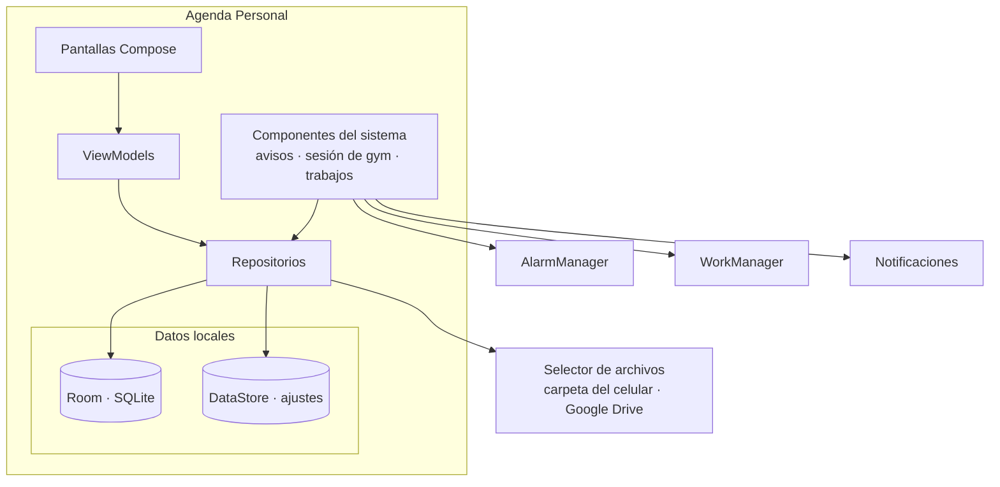
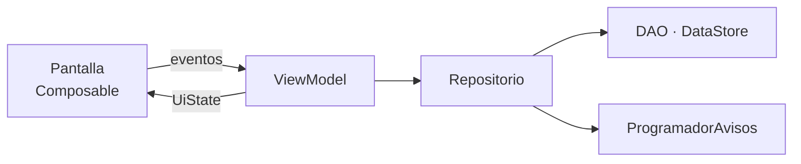
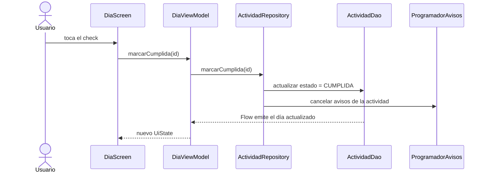

# Arquitectura

Estado: en revisión · Base: [Requerimientos v2.1](00-requerimientos.md), [Modelo de datos](02-modelo-de-datos.md)

---

## 1. Visión general

La app es una sola aplicación Android, sin servidor. Todo pasa en el celular: la interfaz, la base de datos, los avisos y los respaldos.



Cómo cumple cada RNF:

| RNF | Cómo se cumple |
|---|---|
| RNF-01 · Plataforma | `minSdk 26`, Kotlin y Jetpack Compose. Se prueba en un Xiaomi con Android 12 y MIUI 13 (sección 4.6). |
| RNF-02 · Alcance | Sin cuentas, sin red y sin permiso de internet. |
| RNF-03 · Almacenamiento | Room para los datos y DataStore para los ajustes. |
| RNF-04 · Persistencia | Migraciones de Room probadas, nunca destructivas ([modelo de datos §5](02-modelo-de-datos.md#5-versionado-y-migraciones)), y cada versión firmada con la misma clave para instalarse encima de la anterior (sección 5.3). |
| RNF-05 · Respaldo | Storage Access Framework: todos los respaldos van a una carpeta registrada por el usuario, fuera de la app (sección 4.4). |
| RNF-06 · Respaldo | JSON con kotlinx.serialization, con versión de base de datos, fecha y versión de la app. |
| RNF-07 · Confiabilidad | El cronómetro se calcula desde `sesion_gym.inicio`, y un servicio en primer plano mantiene la notificación. |
| RNF-08 · Usabilidad | El check y la confirmación de serie llaman directo al ViewModel, sin diálogos. |
| RNF-09 · Mantenibilidad | MVVM por capas, con dependencias en un solo sentido (sección 2). |
| RNF-10 · Notificaciones | Permiso `POST_NOTIFICATIONS` en Android 13 o superior y alarmas exactas con `AlarmManager`, con `setAlarmClock` para los avisos puntuales (sección 4.2). |
| RNF-11 · Compatibilidad con MIUI | Guía para el inicio automático y la batería, y una comprobación de pendientes al abrir la app (sección 4.6). |

---

## 2. Capas MVVM



Las dependencias van en un solo sentido: una capa solo conoce a la de abajo.

| Capa | Responsabilidad | No hace |
|---|---|---|
| **Pantalla** (Composable) | Dibuja el `UiState` y envía los eventos del usuario al ViewModel. | No guarda estado de negocio ni llama a repositorios. |
| **ViewModel** | Junta los datos de uno o más repositorios en un `UiState`, valida formularios y decide qué mostrar. Sobrevive a la rotación. | No conoce Room, ni `Context`, ni la navegación. |
| **Repositorio** | Es la única puerta a los datos. Contiene las reglas que tocan varias tablas: borrados, generación del gym y transacciones. Avisa a `ProgramadorAvisos` cuando cambia algo con aviso. | No conoce la interfaz. |
| **Datos** (DAO, DataStore) | Leer y escribir. Las lecturas devuelven `Flow`. | No tiene reglas de negocio. |

**Flujo de datos.** El estado baja y los eventos suben:

1. El ViewModel expone un `StateFlow<UiState>` armado con `combine` de los `Flow` de los repositorios.
2. La pantalla lo lee con `collectAsStateWithLifecycle()`.
3. Cada acción del usuario es una función del ViewModel, por ejemplo `marcarCumplida(id)`, que lanza una corrutina en `viewModelScope` y llama al repositorio.
4. Room emite el cambio por el `Flow` y la pantalla se actualiza sola. No hace falta refrescar a mano.

Los eventos de una sola vez, como "Respaldo creado" o navegar después de guardar, salen del ViewModel como un campo del `UiState` que la pantalla consume y limpia.

**Ejemplo: marcar una actividad en el módulo del día (CU-08)**



**Inyección de dependencias.** Es manual, con un `AppContainer` que crea la base de datos, los repositorios y los componentes del sistema una sola vez. Lo crea `TaskToDoApp` (la clase `Application`). Los ViewModels se crean con `viewModelFactory { initializer { … } }` y reciben sus repositorios por el constructor.

**El tiempo se inyecta.** Ninguna clase llama a `LocalDate.now()` directamente: todas reciben un `java.time.Clock` del contenedor. Así las pruebas pueden fijar "hoy" para probar las tareas atrasadas, las semanas y los avisos.

---

## 3. Estructura de paquetes

Un solo módulo `:app`, organizado por capa y, dentro de `ui`, por pantalla. Los nombres del dominio van en español, igual que en el modelo de datos.

```text
com.calendar.tasktodo
├── TaskToDoApp.kt              Application: crea el AppContainer y los canales de notificación
├── MainActivity.kt             Única Activity: tema, permisos y NavHost
├── di/
│   └── AppContainer.kt
├── data/
│   ├── db/
│   │   ├── AgendaDatabase.kt   @Database, versión y migraciones
│   │   ├── Converters.kt       LocalDate, LocalTime, Instant, DayOfWeek
│   │   ├── entidad/            Materia, Clase, Actividad, Rutina, Ejercicio, DiaGym,
│   │   │                       SesionGym, SerieRealizada, RegistroPeso y sus enums
│   │   └── dao/                Un DAO por entidad, más EstadisticasDao
│   ├── ajustes/
│   │   └── AjustesRepository.kt   DataStore: avisos, respaldo, estatura, fin del gym
│   ├── repositorio/
│   │   ├── HorarioRepository.kt       Materias y clases
│   │   ├── ActividadRepository.kt
│   │   ├── GymRepository.kt           Rutinas, ejercicios, programación y generación
│   │   ├── SesionRepository.kt        Sesión en curso y series
│   │   ├── PesoRepository.kt          Registros de peso e IMC
│   │   └── EstadisticasRepository.kt
│   └── respaldo/
│       ├── RespaldoDto.kt             Formato JSON con @Serializable
│       └── RespaldoRepository.kt      Exportar, importar y rotar los últimos 5
├── sistema/
│   ├── avisos/
│   │   ├── ProgramadorAvisos.kt       Programa y cancela alarmas exactas
│   │   ├── CanalesNotificacion.kt
│   │   ├── AvisoReceiver.kt           Muestra el aviso cuando suena la alarma
│   │   ├── AccionAvisoReceiver.kt     Botón "Marcar como cumplida"
│   │   └── ArranqueReceiver.kt        Reprograma todo al reiniciar
│   ├── sesion/
│   │   └── SesionGymService.kt        Servicio en primer plano de la sesión
│   ├── compatibilidad/
│   │   ├── EstadoSistema.kt           Permisos, alarmas exactas y batería
│   │   ├── AjustesFabricante.kt       Abre el inicio automático y la batería en MIUI
│   │   └── PendientesAlAbrir.kt       Reprograma avisos y hace el respaldo atrasado
│   └── trabajos/
│       ├── RespaldoAutomaticoWorker.kt
│       └── MantenimientoDiarioWorker.kt   Extiende la ventana del gym
└── ui/
    ├── theme/
    ├── navegacion/             Rutas tipadas y AgendaNavHost
    ├── componentes/            Piezas reutilizables (ver diseño de interfaz)
    ├── inicio/                 Bienvenida y configuración inicial (CU-01)
    ├── dia/                    Módulo del día (CU-09, CU-10)
    ├── horario/                Materias, clases y horario semanal (CU-02 a CU-05)
    ├── actividades/            Lista, filtros y formulario (CU-06, CU-07)
    ├── calendario/             Semana y mes (CU-11)
    ├── gym/
    │   ├── rutinas/            Rutinas y ejercicios (CU-12, CU-13)
    │   ├── programacion/       CU-14, CU-15
    │   ├── sesion/             CU-16
    │   ├── peso/               CU-17
    │   └── estadisticas/       CU-18
    └── ajustes/                Avisos, respaldo y guía de MIUI (CU-19, CU-21 a CU-23)
```

Cada carpeta de pantalla tiene su `…Screen.kt`, su `…ViewModel.kt` y su `…UiState.kt`. Los paquetes aparecen a medida que llega su incremento.

---

## 4. Componentes de Android

### 4.1 Componentes

| Componente | Clase | Para qué | CU |
|---|---|---|---|
| `Application` | `TaskToDoApp` | Crea el `AppContainer` y los canales de notificación. | Todos |
| `Activity` | `MainActivity` | Única pantalla del sistema. Contiene toda la navegación en Compose. | Todos |
| `BroadcastReceiver` | `AvisoReceiver` | Lo despierta `AlarmManager`. Comprueba que el aviso siga vigente y muestra la notificación. | CU-20 |
| `BroadcastReceiver` | `AccionAvisoReceiver` | Marca la actividad como cumplida desde la notificación, sin abrir la app. | CU-08 |
| `BroadcastReceiver` | `ArranqueReceiver` | Escucha `BOOT_COMPLETED`, `TIME_SET`, `TIMEZONE_CHANGED` y `MY_PACKAGE_REPLACED`, y reprograma todos los avisos. | CU-20 1f |
| `Service` en primer plano | `SesionGymService` | Mantiene la notificación fija de la sesión y avisa al terminar cada descanso. | CU-16 |
| `Worker` | `RespaldoAutomaticoWorker` | Respaldo periódico en la carpeta de respaldos, conservando los últimos 5 automáticos. | CU-24 |
| `Worker` | `MantenimientoDiarioWorker` | Una vez al día, genera las actividades de gym hasta 4 semanas adelante. | CU-14 |

### 4.2 Avisos

- **Código fijo:** el código de cada alarma se deriva del `id` de la actividad y del tipo de aviso. Así se puede cancelar o reemplazar, y reprogramar una actividad nunca la duplica.
- **Ventana de 7 días:** solo se programan los avisos de los próximos 7 días; los demás se programan cuando se acercan, para no tener cientos de alarmas activas. El resumen diario se reprograma para el día siguiente cada vez que suena.

**Dos formas de programar una alarma.** Android ofrece dos tipos de alarma exacta. Para cumplir el margen de ±1 minuto (RNF-10), todos los avisos usan `setAlarmClock`:

| | `setAlarmClock` | `setExactAndAllowWhileIdle` |
|---|---|---|
| Qué es | La alarma del sistema, la misma que usa la app de reloj para los despertadores. | Una alarma exacta normal. |
| En reposo (Doze) | Suena a la hora justa. Android sale del reposo un poco antes para entregarla. | Como máximo una cada 9 minutos por app. Puede retrasarse si coinciden varias. |
| En MIUI | La respeta incluso con ahorro de batería, porque la trata como un despertador. | Puede retrasarla o descartarla si la app no tiene batería sin restricciones. |
| Efecto visible | Muestra el ícono de alarma 🕐 en la barra de estado, y la pantalla de bloqueo muestra la próxima. | Ninguno. |
| Se usa para | Todos los avisos: actividades, día anterior, gym, clases, resumen del día y fin de descanso. | Solo si el usuario desactiva la prioridad de alarma. |

- **Ajuste "Avisos con prioridad de alarma":** está activado por defecto. Si el usuario lo desactiva, para no ver el ícono de alarma, todos los avisos pasan a `setExactAndAllowWhileIdle`. El ajuste advierte que entonces los avisos pueden retrasarse varios minutos en reposo y ya no se garantiza el margen de ±1 minuto.
- **Tocar la alarma:** `setAlarmClock` pide un `PendingIntent` que se abre al tocar la próxima alarma en la pantalla de bloqueo o en el reloj. La app lo apunta al detalle de la actividad.
- **Sin permiso de alarmas exactas:** si el usuario quita el permiso, ninguna de las dos funciona, y la app usa `setAndAllowWhileIdle`. Ese aviso puede llegar con unos minutos de retraso, y la guía de MIUI muestra el permiso como pendiente.
- **Alarmas de la app de reloj:** la app no crea alarmas en la app de reloj con `AlarmClock.ACTION_SET_ALARM`, porque después no puede cancelarlas ni reemplazarlas, y reprogramar una actividad dejaría duplicados.
- Antes de mostrar un aviso, el receptor vuelve a leer la base de datos: si la actividad ya está cumplida o el tipo se desactivó, no muestra nada (CU-20 2a).

Canales de notificación, que el usuario puede ajustar también desde Android:

| Canal | Importancia | Uso |
|---|---|---|
| Actividades | Alta | Avisos de actividad y del día anterior. |
| Gym | Alta | Aviso antes de la sesión. |
| Clases | Por defecto | Aviso antes de clase. |
| Resumen del día | Por defecto | Resumen de la mañana. |
| Sesión en curso | Baja, sin sonido | Notificación fija con el cronómetro. |
| Fin de descanso | Alta, con vibración | Aviso al terminar un descanso. |
| Respaldo | Baja | Respaldo automático fallido o más de una semana sin respaldo. |

### 4.3 Sesión de gym

- Al iniciar la sesión se guarda `inicio` en la base de datos y se arranca `SesionGymService`.
- La notificación usa el cronómetro propio de Android (`setUsesChronometer`), así que el servicio no la actualiza cada segundo. Durante un descanso muestra la cuenta regresiva (`setChronometerCountDown`) hasta `descanso_termina_en`.
- El fin del descanso se avisa con `setAlarmClock`, que llega a la hora justa aunque la app esté cerrada o el celular en reposo.
- Si Android cierra la app, al volver se lee la sesión `EN_CURSO` y todo se recalcula desde los instantes guardados (RNF-07).
- El servicio se declara con `foregroundServiceType="specialUse"`. El tipo `health` exigiría permisos de sensores que la app no usa, y la app no pasa por la revisión de Play Store (RNF-02). Ese tipo existe desde Android 14: en Android 12 se ignora, y el servicio se arranca con `ServiceCompat.startForeground`, que funciona en ambas versiones.
- Android 12 no deja iniciar un servicio en primer plano desde segundo plano. Por eso el servicio solo se arranca cuando el usuario toca "Iniciar sesión", con la app abierta.

### 4.4 Respaldo

| Acción | API de Android |
|---|---|
| Registrar la carpeta de respaldos (CU-23) | `ActivityResultContracts.OpenDocumentTree` con `EXTRA_INITIAL_URI` en Documentos, y `takePersistableUriPermission` para que el permiso sobreviva a reinicios. |
| Respaldar ahora (CU-21) | `DocumentFile.fromTreeUri(carpeta).createFile(...)`, sin abrir ningún selector. |
| Copia en otra ubicación (CU-21 1a) | `ActivityResultContracts.CreateDocument("application/json")`. Sirve para cualquier destino, incluido Google Drive. |
| Listar respaldos para restaurar (CU-22) | `DocumentFile.listFiles()` de la carpeta, filtrando los nombres `agenda-*.json`. |
| Restaurar desde otra ubicación (CU-22 2b) | `ActivityResultContracts.OpenDocument`. |
| Rotar los últimos 5 (CU-24) | `DocumentFile` lista los archivos con el prefijo `agenda-auto-` y borra los más antiguos. Lo mismo con `agenda-seguridad-`. |

**Nombres de los archivos.** Todos van a la carpeta registrada, con un prefijo según su origen:

| Prefijo | Origen | Se borra solo |
|---|---|---|
| `agenda-manual-AAAA-MM-DD-HHmm.json` | "Respaldar ahora" (CU-21) | Nunca |
| `agenda-auto-AAAA-MM-DD-HHmm.json` | Respaldo automático (CU-24) | Sí, conserva los últimos 5 |
| `agenda-seguridad-AAAA-MM-DD-HHmm.json` | Antes de restaurar (CU-22) | Sí, conserva los últimos 5 |

**Después de reinstalar,** la app pierde el permiso sobre la carpeta, porque Android lo borra al desinstalar. Los archivos siguen ahí. Basta con registrar de nuevo la misma carpeta para ver y restaurar los respaldos (CU-01 2a).

Google Drive no se puede registrar como carpeta, porque su proveedor no permite elegir carpetas con `OpenDocumentTree`. Por eso la copia a Drive es una opción aparte, con `CreateDocument`. También se puede sincronizar la carpeta con una app externa (RNF-05).

El respaldo automático de Android (`allowBackup`) se desactiva. El respaldo propio de la app es la única copia, y así no se mezclan dos mecanismos al reinstalar.

### 4.5 Permisos

| Permiso | Para qué |
|---|---|
| `POST_NOTIFICATIONS` | Mostrar avisos en Android 13 o superior. Se pide en tiempo de ejecución (CU-19 1a). En Android 12 no existe: las notificaciones están permitidas por defecto. |
| `SCHEDULE_EXACT_ALARM` (`maxSdkVersion="32"`) | Alarmas exactas en Android 12 y 12L. Se concede al instalar, pero el usuario puede quitarlo, así que la app lo comprueba con `canScheduleExactAlarms()`. |
| `USE_EXACT_ALARM` | Alarmas exactas en Android 13 o superior. Se concede al instalar, porque la app es una agenda. |
| `REQUEST_IGNORE_BATTERY_OPTIMIZATIONS` | Pedir que Android no restrinja la batería de la app (sección 4.6). |
| `RECEIVE_BOOT_COMPLETED` | Reprogramar los avisos al reiniciar. |
| `FOREGROUND_SERVICE` y `FOREGROUND_SERVICE_SPECIAL_USE` | Servicio de la sesión de gym. |
| `VIBRATE` | Vibración al terminar un descanso. |

La app no pide permiso de internet ni de almacenamiento: el selector de archivos da acceso solo al archivo o la carpeta que el usuario elige.

### 4.6 Android 12 y MIUI 13

El dispositivo principal es un Xiaomi con Android 12 (API 31) y MIUI 13 (RNF-01, RNF-11). Con `minSdk 26` la app se instala sin cambios; lo que hay que cuidar es el trabajo en segundo plano, porque MIUI es más estricto que Android.

**Qué hace MIUI 13 por defecto y cómo afecta a la app**

| Restricción de MIUI | Qué rompe | Solución en la app |
|---|---|---|
| **Inicio automático** desactivado para apps instaladas por APK o desde Android Studio. | No llega `BOOT_COMPLETED`: los avisos no se reprograman tras reiniciar. Con la app cerrada, MIUI también puede descartar sus alarmas. | Guía que abre la pantalla de inicio automático de MIUI para activarlo. |
| **Ahorro de batería** en modo "Inteligente". | Retrasa o descarta las alarmas, los workers y el servicio de la sesión. | Pedir "Sin restricciones" con `ACTION_REQUEST_IGNORE_BATTERY_OPTIMIZATIONS` y abrir el ajuste de batería de MIUI. |
| **Limpieza de recientes**: al deslizar para cerrar, MIUI mata el proceso. | Se cancelan las alarmas pendientes y se detiene el servicio. | Recomendar bloquear la app en recientes (el candado). El cronómetro y la sesión se recuperan desde la base de datos (RNF-07). |
| **Notificaciones**: las nuevas apps pueden quedar sin ventana flotante ni pantalla de bloqueo. | Los avisos llegan sin sonar ni mostrarse arriba. | La guía abre los ajustes de notificación de la app. Los canales se crean con importancia alta (sección 4.2). |

**Guía de MIUI.** Es una pantalla en los ajustes, y también se muestra una vez al terminar la configuración inicial (CU-01) y en los ajustes de avisos (CU-19). Muestra el estado de cada punto y un botón que abre el ajuste de MIUI que corresponde:

- **Lo que se puede comprobar:** alarmas exactas (`canScheduleExactAlarms()`), batería sin restricciones (`isIgnoringBatteryOptimizations()`) y notificaciones activadas (`areNotificationsEnabled()`).
- **Lo que no se puede comprobar:** el inicio automático y el candado en recientes. MIUI no ofrece una forma de leerlos, así que la guía los muestra como pasos manuales con su explicación.
- **Cómo abre los ajustes de MIUI:** `AjustesFabricante` intenta abrir la pantalla propia de MIUI (Seguridad → Inicio automático) y, si no existe en esa versión, abre los detalles de la app en Android.
- **Cuándo aparece:** solo cuando `Build.MANUFACTURER` es Xiaomi, Redmi o POCO. En otros fabricantes la guía muestra solo los puntos de Android.

**Comprobación al abrir (`PendientesAlAbrir`).** Cada vez que la app pasa a primer plano, hace lo que MIUI pudo haber impedido:

1. Reprograma los avisos de los próximos días. Es seguro repetirlo, porque cada alarma tiene un código fijo y se reemplaza.
2. Si el respaldo automático está atrasado según su frecuencia, lo hace en ese momento (CU-24 1b).
3. Extiende la ventana de actividades de gym si quedó corta.
4. Si hay una sesión `EN_CURSO`, la retoma y vuelve a arrancar el servicio.

**Alarmas en reposo.** En modo de reposo profundo (Doze), Android permite como máximo una alarma `setExactAndAllowWhileIdle` cada 9 minutos por app. Por eso todos los avisos y el fin de un descanso usan `setAlarmClock`, que no tiene ese límite y que MIUI respeta como un despertador (sección 4.2).

**Instalar en el Xiaomi.** Para instalar desde Android Studio, en las opciones de desarrollador de MIUI hay que activar "Depuración USB", "Instalar vía USB" y "Depuración USB (ajustes de seguridad)". MIUI pide iniciar sesión con una cuenta Mi y, a veces, tener una SIM puesta para activar las dos últimas. Para instalar el APK directamente, hay que permitir la instalación de apps desconocidas al gestor de archivos.

---

## 5. Librerías y versiones

### 5.1 Base del proyecto

Estas versiones ya están en el proyecto:

| Elemento | Versión |
|---|---|
| Android Gradle Plugin | 9.5.0, con soporte de Kotlin integrado |
| Gradle | 9.6.0 |
| Kotlin | 2.2.10 |
| `compileSdk` y `targetSdk` | 37 |
| `minSdk` | 26 |
| Compose BOM | 2026.02.01 |
| Java | 11 |

`core-ktx` (1.10.1), `lifecycle-runtime-ktx` (2.6.1) y `activity-compose` (1.8.0) vienen de la plantilla y son antiguas. Se actualizan al empezar el incremento 1.

### 5.2 Librerías por agregar

Las versiones exactas se fijan en `gradle/libs.versions.toml` al empezar el incremento que las necesita, con la última estable compatible. KSP debe coincidir con la versión de Kotlin.

| Librería | Para qué | Incremento |
|---|---|---|
| Room (`room-runtime`, `room-ktx`, `room-compiler` con KSP) | Base de datos, `Flow` y migraciones. | 1 |
| KSP | Procesador de anotaciones de Room. | 1 |
| Navigation Compose | Navegación con rutas tipadas. | 1 |
| kotlinx.serialization (plugin y `json`) | Rutas de navegación y JSON del respaldo. | 1 |
| Lifecycle (`viewmodel-compose`, `runtime-compose`) | ViewModels en Compose y `collectAsStateWithLifecycle`. | 1 |
| DataStore Preferences | Ajustes. | 1 |
| WorkManager (`work-runtime-ktx`) | Respaldo automático y mantenimiento diario. | 3 |
| Reorderable (`sh.calvin.reorderable`) | Arrastrar para reordenar ejercicios (CU-13 2d). | 5 |
| Vico (`compose-m3`) | Gráficas de estadísticas (CU-18). | 6 |

Pruebas: JUnit 4, `kotlinx-coroutines-test`, Turbine (para probar `Flow`), `room-testing` (`MigrationTestHelper`), `work-testing` y Compose UI Test. El detalle va en el [plan de pruebas](06-plan-de-pruebas.md).

### 5.3 Firma, versiones e instalación

Cada versión nueva se instala **encima** de la anterior, nunca desinstalando, para conservar los datos (RNF-04). Android solo lo permite si se cumplen tres condiciones; si falta alguna, rechaza la instalación y la única salida es desinstalar, lo que borra los datos.

| Condición | Cómo se cumple |
|---|---|
| **El mismo `applicationId`** | Siempre `com.calendar.tasktodo` para la app de uso diario. No se cambia nunca. |
| **La misma clave de firma** | Una clave propia, `agenda-release.jks`, creada una vez con Android Studio (Build → Generate Signed App Bundle or APK). No se usa la clave de depuración, porque es distinta en cada computadora y se pierde al reinstalar Android Studio. |
| **Un `versionCode` mayor que el instalado** | Sube en 1 con cada APK que se instala en el celular. Android no permite bajar de versión. |

**La clave de firma**

- **Dónde va:** el archivo `.jks` y sus contraseñas van **fuera del repositorio**. Las contraseñas se guardan en `keystore.properties`, que está en `.gitignore`, y `build.gradle.kts` las lee desde ahí en `signingConfigs`.
- **Respaldo:** la clave se respalda en dos lugares, por ejemplo un USB y Google Drive. Si se pierde, ninguna versión futura podrá instalarse encima y habrá que desinstalar, después de un respaldo de datos (CU-21) para restaurarlo luego.

**Dos variantes de la app**

| Variante | `applicationId` | Nombre visible | Firma | Para qué |
|---|---|---|---|---|
| `release` | `com.calendar.tasktodo` | Agenda | `agenda-release.jks` | La app de uso diario, con tus datos reales. |
| `debug` | `com.calendar.tasktodo.debug` | Agenda (dev) | Clave de depuración | Desarrollo y pruebas desde Android Studio. |

Con `applicationIdSuffix = ".debug"`, la versión de desarrollo se instala **al lado** de la real y tiene su propia base de datos. Así, probar un incremento a medio hacer, o desinstalar la de desarrollo, nunca toca los datos reales.

**Números de versión**

| Campo | Regla | Ejemplo |
|---|---|---|
| `versionCode` | Entero que sube en 1 con cada APK instalado en el celular. | 1, 2, 3… |
| `versionName` | `<incremento>.<entrega>`: la entrega vuelve a 0 al empezar un incremento. | `1.0`, `1.1`, `2.0` |
| Versión de la base de datos | Independiente; sube solo cuando cambia el esquema ([modelo de datos §5](02-modelo-de-datos.md#5-versionado-y-migraciones)). | 1 a 4 |

**Cómo instalar una versión nueva en el Xiaomi**

1. Hacer un respaldo con "Respaldar ahora", por precaución.
2. Generar el APK `release` firmado con `agenda-release.jks`.
3. Instalarlo encima: `adb install -r app-release.apk`, o abrir el APK en el celular y tocar "Actualizar".
4. Abrir la app y comprobar con la lista de humo (plan de pruebas §3.7) que los datos siguen ahí.

**Si Android Studio o el celular ofrecen desinstalar,** porque detectan una firma distinta (`INSTALL_FAILED_UPDATE_INCOMPATIBLE`), **no se acepta**. Significa que el APK no se firmó con `agenda-release.jks`. Se corrige la firma y se vuelve a instalar.

**La compilación `release` tiene R8 activado** (`optimization { enable = true }` en `build.gradle.kts`). Room y kotlinx.serialization necesitan reglas para que R8 no borre sus clases, y la prueba de actualización se hace siempre con el APK `release`, no con el de depuración.

---

## 6. Decisiones de arquitectura

| # | Decisión | Alternativa descartada | Motivo |
|---|---|---|---|
| 1 | Una sola Activity con Navigation Compose. | Una Activity por pantalla. | Es el modelo recomendado para Compose y comparte el estado sin `Intent`. |
| 2 | Inyección de dependencias manual con `AppContainer`. | Hilt. | La app es pequeña y de un solo módulo; Hilt suma plugins y tiempo de compilación sin aportar mucho aquí. Se puede migrar después. |
| 3 | Sin capa de dominio: las reglas viven en los repositorios. | Clases de caso de uso por cada operación. | RNF-09 pide cuatro capas, y la mayoría de las reglas son de datos. Si un repositorio crece demasiado, sus reglas se separan en una clase propia. |
| 4 | `Clock` inyectado. | `LocalDate.now()` directo. | Las reglas dependen de "hoy" y deben poder probarse. |
| 5 | Avisos con `AlarmManager`; tareas periódicas con `WorkManager`. | Todo con `WorkManager`. | `WorkManager` no garantiza la hora exacta (RNF-10); el respaldo sí puede esperar. |
| 5b | `setAlarmClock` para todos los avisos, con un ajuste para desactivarlo. | Solo `setExactAndAllowWhileIdle`, o crear alarmas en la app de reloj. | No se retrasa en reposo y MIUI la respeta, así que cumple el margen de ±1 minuto (RNF-10). Las alarmas de la app de reloj no se pueden cancelar ni reemplazar. |
| 5c | Una carpeta de respaldos registrada para todos los respaldos. | Elegir una ubicación en cada respaldo. | Respaldar toma un toque, los archivos quedan juntos y restaurar muestra la lista sin buscar. |
| 6 | Servicio en primer plano de tipo `specialUse`. | Tipo `health`. | `health` exige permisos de sensores que la app no necesita. |
| 7 | `allowBackup="false"`. | Dejar el respaldo de Android activado. | Una sola fuente de respaldo, controlada por la app (RNF-05). |
| 8 | kotlinx.serialization para el JSON. | Gson o Moshi. | Ya hace falta para la navegación y no usa reflexión. |
| 9 | Nombres del dominio en español. | Inglés. | Coinciden con los documentos y el modelo de datos. |
| 10 | Guía de MIUI y comprobación de pendientes al abrir. | Confiar solo en las alarmas y los workers. | MIUI 13 puede descartarlos con la app cerrada; la comprobación al abrir recupera lo que se perdió (RNF-11). |
