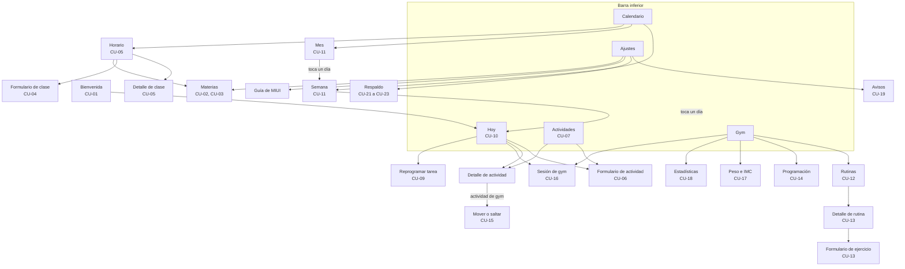

# Diseño de interfaz

Estado: en revisión · Base: [Casos de uso](01-casos-de-uso.md), [Modelo de datos](02-modelo-de-datos.md), [Arquitectura](03-arquitectura.md)

---

## 1. Principios de diseño

1. **Hoy primero.** La app abre en el módulo del día (RF-18). Lo urgente, las tareas atrasadas, va arriba y destacado.
2. **Un toque para lo frecuente.** Marcar una actividad y confirmar una serie toman un toque, sin diálogos (RNF-08). El área táctil mínima es de 48 dp.
3. **Confirmar solo lo que no se deshace.** Borrar pide confirmación. Marcar o desmarcar no la pide, porque se deshace tocando otra vez.
4. **La materia se reconoce de un vistazo, pero no solo por el color.** Cada clase y actividad lleva una franja con el color de su materia y su nombre escrito, para quien no distingue bien los colores.
5. **Nunca una pantalla vacía sin salida.** Cada lista vacía explica por qué y ofrece la acción para llenarla.
6. **El gym se lee de lejos.** La pantalla de sesión usa números grandes y botones anchos, y deja la pantalla encendida mientras dura la sesión.
7. **Formato local.** Fechas en español ("vie 30 oct"), semana que empieza el lunes y horas en 12 o 24 horas según el ajuste del celular.

**Estilo visual**

- **Material 3** con Jetpack Compose.
- **Sin color dinámico.** MIUI 13 no aplica bien los colores del fondo de pantalla de Android 12, así que la app usa su propia paleta fija. En `Theme.kt` se pone `dynamicColor = false`.
- **Tema claro y oscuro** según el sistema.
- **Colores de materia:** una paleta de 12 colores con buen contraste en ambos temas. El usuario elige uno de ellos en vez de un color libre, para que el texto encima siempre se lea.
- **Tipos de actividad:** cada tipo tiene un ícono fijo, así se distinguen aunque tengan la misma materia.

| Tipo | Ícono |
|---|---|
| Tarea | Lista con check |
| Charla | Micrófono |
| Simulacro | Cronómetro |
| Examen | Hoja con lápiz |
| Gym | Pesa |

---

## 2. Mapa de navegación

Una barra inferior con cinco secciones. Los formularios, los detalles y la sesión de gym se abren encima, sin la barra.



**Reglas de navegación**

- **Atrás** vuelve a la pantalla anterior. Desde una sección de la barra, vuelve a Hoy, y desde Hoy cierra la app.
- **Una notificación** abre directo su destino: un aviso abre el detalle de la actividad, la notificación fija abre la sesión de gym y el resumen abre Hoy.
- **Calendario** recuerda la última pestaña usada: Semana, Mes u Horario.
- **Las rutas son tipadas** (ver [arquitectura §3](03-arquitectura.md#3-estructura-de-paquetes)). Por ejemplo, `Dia(fecha)` abre el módulo de una fecha y `Sesion(actividadId)` abre la sesión de una actividad.

**Pantallas por incremento**

| Pantalla | Ruta | CU | Incremento |
|---|---|---|---|
| Bienvenida | `Bienvenida` | CU-01 | 1 |
| Hoy (módulo del día) | `Dia(fecha)` | CU-08, CU-09, CU-10 | 1, ampliada en 2 y 5 |
| Horario semanal | `Horario` | CU-05 | 1 |
| Materias | `Materias` | CU-02, CU-03 | 1 |
| Formulario de materia | `FormMateria(id?)` | CU-02 | 1 |
| Detalle de clase | `DetalleClase(id)` | CU-05 | 1, ampliada en 2 |
| Formulario de clase | `FormClase(id?, materiaId?)` | CU-04 | 1 |
| Actividades | `Actividades` | CU-07 | 2 |
| Formulario de actividad | `FormActividad(id?, fecha?)` | CU-06 | 2 |
| Detalle de actividad | `DetalleActividad(id)` | CU-06, CU-08, CU-15 | 2 |
| Ajustes y avisos | `Ajustes`, `AjustesAvisos` | CU-19 | 2 |
| Guía de MIUI | `GuiaMiui` | CU-01, CU-19 | 2 |
| Respaldo | `AjustesRespaldo` | CU-21, CU-22, CU-23 | 3 |
| Semana | Pestaña de `Calendario` | CU-11 | 4 |
| Mes | Pestaña de `Calendario` | CU-11 | 4 |
| Día abierto desde la semana | `DiaDesdeCalendario(fecha)` | CU-10, CU-11 | 4 |
| Gym (inicio) | `Gym` | — | 5 |
| Rutinas | `Rutinas` | CU-12 | 5 |
| Detalle de rutina | `DetalleRutina(id)` | CU-12, CU-13 | 5 |
| Formulario de ejercicio | `FormEjercicio(rutinaId, id?)` | CU-13 | 5 |
| Programación del gym | `Programacion` | CU-14 | 5 |
| Sesión de gym | `Sesion(actividadId)` | CU-16 | 5 |
| Peso e IMC | `Peso` | CU-17 | 6 |
| Estadísticas | `Estadisticas` | CU-18 | 6 |

Semana, Mes y Horario son pestañas de una sola pantalla, `Calendario`, que tiene el botón "Materias" en su barra superior. Un día abierto desde la semana usa su propia ruta, `DiaDesdeCalendario`: muestra el módulo del día con una flecha para volver al calendario y sin barra inferior, para que el botón "Hoy" siempre vuelva al día actual.

En el incremento 1, la barra inferior solo tiene **Hoy**, **Calendario** (con la pestaña Horario) y **Ajustes**. Las demás secciones aparecen con su incremento.

---

## 3. Pantallas y wireframes

Los wireframes muestran la distribución y el contenido, no el estilo final. `▌` es la franja con el color de la materia.

### 3.1 Bienvenida (CU-01)

Primero, la decisión que importa: empezar de cero o recuperar los datos.

```text
┌──────────────────────────────────┐
│                                  │
│  TaskToDo                        │
│                                  │
│  ¿Es la primera vez que usas     │
│  la app?                         │
│                                  │
│  ┌────────────────────────────┐  │
│  │ Empezar desde cero         │  │
│  │ Agrega tus materias y tu   │  │
│  │ horario.                   │  │
│  └────────────────────────────┘  │
│  ┌────────────────────────────┐  │
│  │ Restaurar mis datos        │  │
│  │ Reinstalé la app: elijo la │  │
│  │ carpeta de mis respaldos.  │  │
│  └────────────────────────────┘  │
└──────────────────────────────────┘
```

- **"Restaurar mis datos"** abre la pantalla de Respaldo y, sin más toques, el selector de carpetas. Al elegir la carpeta aparece la lista de respaldos. Al restaurar, la app va a Hoy (CU-01 2a).
- **"Empezar desde cero"** lleva a la guía del horario:

```text
┌──────────────────────────────────┐
│  TaskToDo                        │
│  Empecemos con tu horario.       │
│  Agrega tus materias y en qué    │
│  días y horas tienes clase.      │
│                                  │
│  Materias                        │
│  ▌ Cálculo          3 clases  ›  │
│  ▌ Física           2 clases  ›  │
│  ┌────────────────────────────┐  │
│  │ + Agregar materia          │  │
│  └────────────────────────────┘  │
│                                  │
│  Omitir              [ Listo ]   │
└──────────────────────────────────┘
```

- Al tocar una materia se abren sus clases para agregarlas (CU-04).
- "Listo" se activa con al menos una materia. En un Xiaomi, después muestra la guía de MIUI (CU-01 7a).
- Si ya hay materias, la pregunta inicial no se muestra.
- En una versión anterior, la restauración era un enlace al pie de esta pantalla ("¿Reinstalaste la app? Restaurar un respaldo"). En las pruebas del incremento 3 no se reconoció como botón, y se reemplazó por la pregunta inicial.

### 3.2 Hoy · módulo del día (CU-08, CU-09, CU-10)

```text
┌──────────────────────────────────┐
│  ‹    Viernes 30 de octubre    › │
│                Hoy          📅   │
├──────────────────────────────────┤
│  ⚠ ATRASADAS (2)                 │
│  ☐ Informe de laboratorio   ⋮    │
│    ▌ Física · hace 3 días        │
│  ☐ Ejercicios capítulo 4    ⋮    │
│    ▌ Cálculo · hace 1 día        │
├──────────────────────────────────┤
│  07:00  ▌ Cálculo                │
│  09:00    Clase · Aula 204       │
│                                  │
│  10:30 ☐ 📝 Examen parcial       │
│           ▌ Física               │
│                                  │
│  18:00  🏋 Pierna           ›    │
│           Gym · 6 ejercicios     │
│                                  │
│  SIN HORA                        │
│  ☑ 🗒 Leer artículo              │
├──────────────────────────────────┤
│                             ( + )│
├──────────────────────────────────┤
│  Hoy  Calendario  Activ.  Gym  ⚙ │
└──────────────────────────────────┘
```

- **Cambiar de día:** con las flechas, deslizando de lado o tocando el calendario 📅, que abre un selector de fecha. Si no estás en hoy, aparece un botón "Hoy" para volver.
- **Atrasadas:** la sección solo aparece en el día actual. El menú `⋮` de cada tarea ofrece **Reprogramar** (abre el selector de fecha, solo hoy o después) y **Borrar**.
- **Clases:** no tienen check, porque no son algo por hacer. Al tocarlas se abre su detalle.
- **Actividades:** el check está a la izquierda, con su área de 48 dp. Una actividad cumplida se ve tachada y atenuada.
- **Gym:** no tiene check. Al tocarla se abre la sesión (CU-16). Si ya se hizo, muestra "Hecha · 52 min"; si pasó sin hacerse, "No realizada".
- **Días pasados:** los exámenes, simulacros y charlas sin check muestran "No marcado".
- **El botón `+`** abre el formulario de actividad con la fecha del día (RF-21).
- **Vacío:** "No hay nada para este día" con el botón "Agregar actividad".

### 3.3 Formulario de actividad (CU-06)

```text
┌──────────────────────────────────┐
│  ✕   Nueva actividad   [Guardar] │
├──────────────────────────────────┤
│  Título                          │
│  ┌────────────────────────────┐  │
│  │ Examen parcial             │  │
│  └────────────────────────────┘  │
│  Tipo                            │
│  (Tarea) (Charla) (Simulacro)    │
│  [Examen]                        │
│                                  │
│  📅 Vie 6 nov      🕐 10:30   ✕  │
│  ▌ Física                   ▾    │
│                                  │
│  🔔 Aviso      30 min antes  ▾   │
│     También se avisa el día      │
│     anterior a las 20:00.        │
│                                  │
│  Notas                           │
│  ┌────────────────────────────┐  │
│  │ Capítulos 3 a 5            │  │
│  └────────────────────────────┘  │
│                                  │
│  (En edición: 🗑 Eliminar)       │
└──────────────────────────────────┘
```

- **Tipo:** chips de una sola elección, sin la opción gym.
- **Hora:** opcional; `✕` la quita. Sin hora, el texto del aviso cambia a "a las 08:00", que es la hora fija de los ajustes.
- **Aviso extra:** la nota del día anterior aparece solo en exámenes y simulacros, y solo si ese aviso está activado.
- **Errores:** "Guardar" muestra los campos que faltan debajo de cada uno.

### 3.4 Actividades (CU-07)

```text
┌──────────────────────────────────┐
│  Actividades                 🔍  │
│  [Todas ▾]  [Todas las materias ▾]│
│  ☐ Ver cumplidas                 │
├──────────────────────────────────┤
│  PRÓXIMAS                        │
│  ☐ 📝 Examen parcial   vie 6 nov │
│       ▌ Física                   │
│  ☐ 🗒 Proyecto final  mar 17 nov │
│       ▌ Cálculo                  │
│  PASADAS                         │
│  ☐ ⏱ Simulacro         mar 27 oct│
│       ▌ Física · No marcado      │
├──────────────────────────────────┤
│  Hoy  Calendario  Activ.  Gym  ⚙ │
└──────────────────────────────────┘
```

- Las cumplidas se ocultan por defecto para que la lista no crezca sin fin.
- Si los filtros no dejan ninguna: "Ninguna actividad coincide" con el botón "Quitar filtros".

### 3.5 Calendario · semana (CU-11)

```text
┌──────────────────────────────────┐
│ [Semana]  Mes   Horario          │
│  ‹      26 oct – 1 nov 2026    › │
├──────────────────────────────────┤
│  LUN 26  •                       │
│   07:00 ▌Cálculo   10:00 ⏱Simul. │
│  MAR 27                          │
│   09:00 ▌Física    18:00 🏋Pierna │
│  MIÉ 28                          │
│   07:00 ▌Cálculo                 │
│  JUE 29                          │
│   18:00 🏋 Torso                  │
│  VIE 30  HOY                     │
│   07:00 ▌Cálculo  10:30 📝Examen │
│   18:00 🏋 Pierna                 │
│  SÁB 31                          │
│   —                              │
│  DOM 1                           │
│   —                              │
├──────────────────────────────────┤
│  Hoy  Calendario  Activ.  Gym  ⚙ │
└──────────────────────────────────┘
```

- Cada día es una fila con sus elementos en orden de hora. Al tocar un día se abre su módulo.
- `•` es la señal discreta de un día pasado con actividades sin check (RF-37).
- Se cambia de semana con las flechas o deslizando.

### 3.6 Calendario · mes (CU-11)

```text
┌──────────────────────────────────┐
│  Semana  [Mes]  Horario          │
│  ‹       Noviembre 2026        › │
├──────────────────────────────────┤
│  L    M    M    J    V    S    D │
│                                1 │
│  2    3    4    5    6    7    8 │
│  ●●   ●    ●●   ●    ●●●         │
│  9   10   11   12   13   14   15 │
│  ●    ●●   ●    ●    ●           │
│  …                               │
├──────────────────────────────────┤
│  Vie 6 nov                       │
│  📝 Examen parcial · ▌ Física     │
│  🏋 Pierna · 18:00                │
└──────────────────────────────────┘
```

- **Resumen de cada día:** un punto por actividad, hasta tres. Las clases no se dibujan, porque se repiten todas las semanas y llenarían el mes.
- **Al tocar un día,** se muestra su lista abajo. Un segundo toque, o "Ver semana", abre la semana de ese día (RF-36).
- **Días pasados con actividades sin check:** llevan la misma señal `•` que en la semana, junto al número.

### 3.7 Calendario · horario (CU-02 a CU-05)

```text
┌──────────────────────────────────┐
│  Semana   Mes  [Horario]         │
│                      Materias ›  │
├──────────────────────────────────┤
│  LUNES                           │
│  ▌ 07:00–09:00  Cálculo · A-204  │
│  ▌ 11:00–13:00  Física  · Lab 2  │
│  MARTES                          │
│  ▌ 09:00–11:00  Física  · A-101  │
│  …                               │
│                             ( + )│
└──────────────────────────────────┘
```

- **Al tocar una clase** se abre su detalle: materia, día, horas, aula y, desde el incremento 2, las próximas actividades de su materia (RF-16), con los botones Editar y Eliminar.
- **El formulario de clase** pide materia (lista desplegable), día de la semana (chips L M M J V S D), hora de inicio, hora de fin y aula. Si la clase se cruza con otra, muestra la advertencia con "Guardar igual" (CU-04 3b).
- **Materias** lista nombre, color y número de clases. Su formulario tiene el nombre y la paleta de 12 colores. Al final de la lista está "Eliminar todas las materias" (CU-03), en rojo.

### 3.8 Gym · inicio

```text
┌──────────────────────────────────┐
│  Gym                             │
├──────────────────────────────────┤
│  PRÓXIMA SESIÓN                  │
│  ┌────────────────────────────┐  │
│  │ 🏋 Pierna · Hoy 18:00       │  │
│  │ 6 ejercicios               │  │
│  │ [ Iniciar ]  Mover · Saltar│  │
│  └────────────────────────────┘  │
│                                  │
│  Esta semana: 2 de 3 sesiones    │
│                                  │
│  📋 Rutinas                    › │
│  🗓 Programación               › │
│  ⚖ Peso e IMC     72.5 kg · 23.7 › │
│  📈 Estadísticas               › │
├──────────────────────────────────┤
│  Hoy  Calendario  Activ.  Gym  ⚙ │
└──────────────────────────────────┘
```

- Si hay una sesión en curso, la tarjeta cambia a "Sesión en curso · 23:41" con el botón "Volver a la sesión".
- Sin programación: "Aún no programas tu gym" con el botón "Programar".

### 3.9 Detalle de rutina y ejercicios (CU-12, CU-13)

```text
┌──────────────────────────────────┐
│  ←  Pierna                  ✎  ⋮ │
│     Descanso entre ejercicios 2:00│
├──────────────────────────────────┤
│ ┌──────────────────────────────┐ │
│ │ ≡  1  Sentadilla           ⋮ │ │
│ │       4 × 10 · 60 kg         │ │
│ └──────────────────────────────┘ │
│ ┌──────────────────────────────┐ │
│ │ ≡  2  Prensa               ⋮ │ │
│ │       4 × 12 · 120 kg        │ │
│ └──────────────────────────────┘ │
│ ┌──────────────────────────────┐ │
│ │ ≡  3  Plancha              ⋮ │ │
│ │       3 × 0:45               │ │
│ └──────────────────────────────┘ │
│ ┌──────────────────────────────┐ │
│ │ ≡  4  Peso muerto rumano   ⋮ │ │
│ │       3 × 10 · 40 kg         │ │
│ └──────────────────────────────┘ │
│  ┌────────────────────────────┐  │
│  │ + Agregar ejercicio        │  │
│  └────────────────────────────┘  │
└──────────────────────────────────┘
```

**Cada ejercicio es un bloque que se mueve a cualquier posición (CU-13 2d).** Por ejemplo, para pasar Sentadilla, el 1, al lugar 3:

```text
  Mientras arrastras                 Al soltar
 ┌──────────────────────────────┐   ┌──────────────────────────────┐
 │ ≡  1  Prensa                 │   │ ≡  1  Prensa                 │
 └──────────────────────────────┘   └──────────────────────────────┘
 ┌──────────────────────────────┐   ┌──────────────────────────────┐
 │ ≡  2  Plancha                │   │ ≡  2  Plancha                │
 └──────────────────────────────┘   └──────────────────────────────┘
 ┌ ─ ─ ─ ─ ─ ─ ─ ─ ─ ─ ─ ─ ─ ─ ─┐   ┌──────────────────────────────┐
   aquí cae el bloque               │ ≡  3  Sentadilla             │
 └ ─ ─ ─ ─ ─ ─ ─ ─ ─ ─ ─ ─ ─ ─ ─┘   └──────────────────────────────┘
   ╔════════════════════════════╗   ┌──────────────────────────────┐
   ║ ≡  Sentadilla              ║   │ ≡  4  Peso muerto rumano     │
   ╚════════════════════════════╝   └──────────────────────────────┘
 ┌──────────────────────────────┐
 │ ≡  4  Peso muerto rumano     │
 └──────────────────────────────┘
```

- **Para moverlo:** mantén presionado el bloque, o toca su asa `≡`, y arrástralo. El bloque se levanta (con sombra), los demás se abren para hacerle espacio y una ranura punteada marca dónde caerá. Se puede soltar en **cualquier posición**, no solo al principio o al final.
- **Al soltar:** todos los números se actualizan y el orden se guarda de inmediato, sin botón "Guardar". Un aviso abajo ofrece "Deshacer" por unos segundos.
- **Listas largas:** si arrastras cerca del borde de arriba o de abajo, la lista se desplaza sola. Además, el menú `⋮` tiene **"Mover a la posición…"**, que pide el número de destino (1 a N), útil cuando el ejercicio está lejos.
- **El menú `⋮` de cada bloque** tiene Editar, Duplicar, Mover a la posición… y Eliminar. Al tocar el bloque se abre el ejercicio para consultarlo y editarlo.
- **Accesibilidad:** con TalkBack, cada bloque ofrece las acciones "Subir una posición" y "Bajar una posición", porque arrastrar no es posible con el lector de pantalla.
- **`✎`** edita el nombre y el descanso de la rutina. El menú `⋮` de arriba tiene "Eliminar rutina".
- **Vacía:** "Esta rutina no tiene ejercicios" y el botón "Agregar el primero".

**Formulario de ejercicio**

```text
┌──────────────────────────────────┐
│  ✕   Nuevo ejercicio             │
├──────────────────────────────────┤
│  Nombre                          │
│  ┌────────────────────────────┐  │
│  │ Sentadilla                 │  │
│  └────────────────────────────┘  │
│  Se mide por                     │
│  [Repeticiones]  (Tiempo)        │
│                                  │
│  Series    Repeticiones   Peso   │
│  [ − 4 + ] [ − 10 + ]  [ 60 kg ] │
│                                  │
│  Descanso entre series   1:30  ▾ │
│  Descanso al terminar    —     ▾ │
│    (sin valor: usa el de la      │
│     rutina, 2:00)                │
│  Nota                            │
│  ┌────────────────────────────┐  │
│  │ Bajar hasta 90°            │  │
│  └────────────────────────────┘  │
│                                  │
│  [Guardar y agregar otro]        │
│                      [ Guardar ] │
└──────────────────────────────────┘
```

- Con "Tiempo", el campo de repeticiones cambia a duración (`mm:ss`).
- Series y repeticiones usan botones `−` y `+` para no abrir el teclado. También se puede tocar el número para escribirlo.

### 3.10 Programación del gym (CU-14)

```text
┌──────────────────────────────────┐
│  ←  Programación      [Guardar]  │
├──────────────────────────────────┤
│  ☑ Lunes      18:00   Pierna  ▾  │
│  ☐ Martes                        │
│  ☑ Miércoles  18:00   Torso   ▾  │
│  ☐ Jueves                        │
│  ☑ Viernes    17:00   Pierna  ▾  │
│  ☐ Sábado                        │
│  ☐ Domingo                       │
│                                  │
│  Termina el   Sin fecha de fin ▾ │
└──────────────────────────────────┘
```

- Al marcar un día aparecen su hora y su rutina. La lista de rutinas solo muestra las que tienen ejercicios.
- **Mover o saltar una sesión (CU-15)** se hace desde el detalle de esa actividad o desde la tarjeta "Próxima sesión": "Mover" abre fecha y hora, y "Saltar" pide confirmación.

### 3.11 Sesión de gym (CU-16)

**Haciendo una serie**

```text
┌──────────────────────────────────┐
│  Pierna                   ⏱ 23:41│
│  Ejercicio 2 de 6    ☰ Ejercicios│
├──────────────────────────────────┤
│                                  │
│           PRENSA                 │
│         Serie 2 de 4             │
│                                  │
│   Repeticiones       Peso        │
│   [ −  12  + ]   [ −  120  + ] kg│
│   La última vez: 12 × 115 kg     │
│                                  │
│  ┌────────────────────────────┐  │
│  │                            │  │
│  │      ✓  Serie hecha        │  │
│  │                            │  │
│  └────────────────────────────┘  │
│                                  │
│  ✓ Serie 1 · 12 × 120            │
│                                  │
│  ‹ Anterior     Terminar sesión  │
└──────────────────────────────────┘
```

**En descanso**

```text
┌──────────────────────────────────┐
│  Pierna                   ⏱ 25:10│
│  Ejercicio 2 de 6                │
├──────────────────────────────────┤
│                                  │
│           DESCANSO               │
│                                  │
│             1:12                 │
│        ━━━━━━━━━━━──────         │
│                                  │
│     [ −15 s ]       [ +15 s ]    │
│                                  │
│          [ Saltar ]              │
│                                  │
│  Siguiente: Prensa · Serie 3     │
│                                  │
└──────────────────────────────────┘
```

- **Antes de iniciar** se ve la rutina completa con el botón "Iniciar sesión".
- **"Serie hecha"** es el botón más grande de la pantalla y confirma con un toque (RNF-08). Los valores vienen rellenados con lo que hiciste la última vez o, si no hay registro, con lo de la rutina, y se corrigen con `−` y `+` antes de confirmar.
- **Ejercicios por tiempo:** el botón cambia a "▶ Iniciar 0:45" y muestra la cuenta regresiva. Al terminar, vibra y pide confirmar.
- **"‹ Anterior"** vuelve a ver o corregir la serie anterior.
- **"☰ Ejercicios"** abre la lista de la sesión para cambiar el orden (ver abajo).
- **"Terminar sesión"** muestra un resumen (duración, ejercicios y series) con "Guardar" y "Descartar sesión". Si el orden cambió, pregunta también si se guarda en la rutina.
- **La pantalla no se apaga** mientras la sesión está abierta.

**Lista de ejercicios de la sesión (CU-16 9b)**

Se abre como hoja inferior, sin salir de la sesión.

```text
┌──────────────────────────────────┐
│  Ejercicios de la sesión      ✕  │
├──────────────────────────────────┤
│  HECHOS                          │
│  ✓ Sentadilla           4 de 4   │
│  AHORA                           │
│  ▶ Prensa               1 de 4   │
│  PENDIENTES                      │
│ ┌──────────────────────────────┐ │
│ │ ≡  3  Plancha       0 de 3 ⋮ │ │
│ └──────────────────────────────┘ │
│ ┌──────────────────────────────┐ │
│ │ ≡  4  Peso muerto   0 de 3 ⋮ │ │
│ └──────────────────────────────┘ │
│ ┌──────────────────────────────┐ │
│ │ ≡  5  Zancadas      0 de 3 ⋮ │ │
│ └──────────────────────────────┘ │
│ ┌──────────────────────────────┐ │
│ │ ≡  6  Hip thrust    0 de 4 ⋮ │ │
│ └──────────────────────────────┘ │
└──────────────────────────────────┘
```

- **Los pendientes son bloques,** igual que en la rutina. Se arrastran y se sueltan en **cualquier posición** entre los pendientes, con la misma ranura punteada que marca dónde caen.
- **El menú `⋮`** tiene "Hacer ahora" y "Mover a la posición…".
- **"Hacer ahora"** convierte ese ejercicio en el actual. Si el actual ya tenía series hechas, como Prensa con 1 de 4, vuelve a pendientes con las 3 que le faltan y lo puedes poner en la posición que quieras.
- **Los hechos y el actual** no se arrastran, porque sus series ya están guardadas o en curso. Para cambiar el actual, se usa "Hacer ahora" en otro.
- **Si cambias el orden durante un descanso,** el texto "Siguiente:" se actualiza al momento.

**Notificación fija (RF-30)**

```text
┌──────────────────────────────────┐
│ 🏋 Pierna · 25:10                 │
│ Descanso 1:12 · Siguiente: Prensa│
│ [ Saltar descanso ]              │
└──────────────────────────────────┘
```

### 3.12 Peso e IMC (CU-17)

```text
┌──────────────────────────────────┐
│  ←  Peso e IMC                   │
├──────────────────────────────────┤
│  ┌────────────────────────────┐  │
│  │  72.5 kg      IMC 23.7     │  │
│  │               Normal       │  │
│  │  ├──────┼━━━━●━━┼──────┼─┤ │  │
│  │   18.5      25     30      │  │
│  │  Estatura 175 cm        ✎  │  │
│  └────────────────────────────┘  │
│                                  │
│  vie 30 oct   72.5 kg   IMC 23.7 │
│  vie 23 oct   73.1 kg   IMC 23.9 │
│  vie 16 oct   73.4 kg   IMC 24.0 │
│                             ( + )│
└──────────────────────────────────┘
```

- **La barra del IMC** marca las cuatro categorías de la OMS y dónde está el valor actual. Debajo, en texto pequeño: "Dato orientativo; no reemplaza una evaluación médica."
- **Sin estatura:** en lugar de la tarjeta aparece "Agrega tu estatura para ver tu IMC" con su campo.
- **Agregar** abre una hoja inferior con el peso y la fecha (hoy por defecto). Al tocar un registro se edita, y deslizándolo se elimina con confirmación.

### 3.13 Estadísticas (CU-18)

```text
┌──────────────────────────────────┐
│  ←  Estadísticas                 │
│  (Semana) [Mes] (3 meses) (Todo) │
├──────────────────────────────────┤
│  Minutos entrenados       420 min│
│  ▁▃▅▂▇▅  (barras por semana)     │
│                                  │
│  Sesiones          10 de 12 · 83%│
│  ████████████████░░░░            │
│                                  │
│  Peso e IMC                      │
│  ╲__╱‾╲__  (línea; cambia a IMC) │
│                                  │
│  Fuerza   [ Sentadilla ▾ ]       │
│  ╱‾╱‾‾╱  peso máximo · volumen   │
└──────────────────────────────────┘
```

- Cada gráfica tiene su número principal arriba a la derecha, para leerlo sin interpretar la gráfica.
- En "Peso e IMC" hay un selector para alternar entre ver el peso o el IMC.
- Si una gráfica no tiene datos en el periodo, dice "Sin datos en este periodo" en su lugar.

### 3.14 Ajustes (CU-19, CU-21 a CU-23)

```text
┌──────────────────────────────────┐
│  Ajustes                         │
├──────────────────────────────────┤
│  ⚠ Han pasado 9 días sin         │
│    respaldo.     [Respaldar ya]  │
├──────────────────────────────────┤
│  AVISOS                        › │
│  RESPALDO                      › │
│    Último: jue 22 oct            │
│  GUÍA DE MIUI                  › │
│    2 de 4 pasos listos           │
│  MATERIAS                      › │
│  ACERCA DE                       │
│    Versión 1.0 · base de datos 4 │
└──────────────────────────────────┘
```

- **Avisos:**
  - Un interruptor por tipo, cada uno con su hora o sus minutos debajo. Avisos de clase viene apagado.
  - Al final está "Avisos con prioridad de alarma", activado, con la explicación: "Usa la alarma del sistema para que los avisos lleguen a la hora justa. Muestra el ícono de alarma en la barra de estado." Al desactivarlo, pide confirmar con la advertencia: "Los avisos pueden llegar con varios minutos de retraso cuando el celular está en reposo."
  - Si falta el permiso de alarmas exactas, una tarjeta arriba lo explica con el botón "Permitir".

**Respaldo (CU-21 a CU-23)**

```text
┌──────────────────────────────────┐
│  ←  Respaldo                     │
├──────────────────────────────────┤
│  CARPETA DE RESPALDOS            │
│  📁 Documentos/AgendaRespaldos   │
│     12 respaldos   [Cambiar]     │
│                                  │
│  ┌────────────────────────────┐  │
│  │     Respaldar ahora        │  │
│  └────────────────────────────┘  │
│  Último: jue 22 oct, 21:15       │
│                                  │
│  Restaurar respaldo            › │
│  Guardar una copia en otra       │
│  ubicación (Google Drive…)     › │
│                                  │
│  RESPALDO AUTOMÁTICO      [ ● ]  │
│  Frecuencia          Semanal  ▾  │
│  Conserva los últimos 5          │
└──────────────────────────────────┘
```

- **Sin carpeta registrada:** la sección de arriba cambia a "Elige dónde guardar tus respaldos" con el botón "Elegir carpeta", y los demás botones quedan desactivados hasta registrarla.
- **"Respaldar ahora"** guarda directo en la carpeta, sin preguntar nada.
- **"Restaurar respaldo"** muestra la lista de la carpeta, con una etiqueta por tipo (Manual, Automático o Seguridad), y al final "Buscar en otra ubicación". Al elegir un archivo, muestra un resumen (fecha y cuántos datos de cada tipo) antes de pedir confirmación.

**Guía de MIUI**

```text
┌──────────────────────────────────┐
│  ←  Guía de MIUI                 │
│  Para que los avisos lleguen a   │
│  tiempo en tu Xiaomi:            │
├──────────────────────────────────┤
│  ✅ Alarmas exactas              │
│  ⚠ Batería sin restricciones     │
│     [ Abrir ajuste ]             │
│  ✅ Notificaciones activadas     │
│  ◻ Inicio automático             │
│     Actívalo en Seguridad →      │
│     Inicio automático.           │
│     [ Abrir ajuste ] [ Hecho ]   │
│  ◻ Bloquear en recientes         │
│     Abre recientes, mantén la    │
│     app presionada y toca 🔒.    │
│     [ Hecho ]                    │
└──────────────────────────────────┘
```

- Los tres primeros puntos se comprueban solos cada vez que se abre la pantalla.
- Los dos últimos no se pueden comprobar, así que el usuario los marca con "Hecho".

---

## 4. Componentes reutilizables

Viven en `ui/componentes/`. Cada uno tiene su vista previa (`@Preview`) en tema claro y oscuro.

| Componente | Qué muestra | Dónde se usa |
|---|---|---|
| `FranjaMateria` | Barra vertical con el color de la materia. | Todas las filas de clase y actividad |
| `FilaClase` | Hora de inicio y fin, materia y aula. | Hoy, Semana, Horario |
| `FilaActividad` | Check, ícono del tipo, título, materia, hora y estado (cumplida, atrasada, no marcada). | Hoy, Actividades, Detalle de clase |
| `FilaGym` | Rutina, hora y estado (pendiente, hecha, no realizada, saltada). | Hoy, Semana |
| `SeccionAtrasadas` | Encabezado destacado y las tareas atrasadas con sus días de atraso y su menú. | Hoy |
| `CabeceraFecha` | Fecha con flechas anterior y siguiente, y botón de calendario. | Hoy, Semana, Mes |
| `EstadoVacio` | Ícono, mensaje y botón de acción. | Todas las listas |
| `DialogoConfirmar` | Título, explicación de lo que se perderá y botón destructivo en rojo. | Todos los borrados, importar respaldo |
| `SelectorColorMateria` | Cuadrícula con los 12 colores de la paleta. | Formulario de materia |
| `CampoFecha`, `CampoHora` | Campo que abre el selector de Material 3. | Formularios |
| `CampoDuracion` | Duración en `mm:ss`, con opción "sin valor". | Ejercicio, rutina, avisos |
| `ContadorNumero` | Número con botones `−` y `+`, y escritura directa. | Ejercicio, sesión de gym |
| `ChipsFiltro` | Chips de una o varias opciones. | Tipo de actividad, días de la semana, periodo |
| `ContadorDescanso` | Cuenta regresiva con barra, `−15 s`, `+15 s` y "Saltar". | Sesión de gym |
| `TarjetaIMC` | Peso, IMC, categoría y barra de categorías. | Peso e IMC, Gym |
| `TarjetaGrafica` | Título, número principal y la gráfica, o "Sin datos". | Estadísticas |
| `PasoGuia` | Estado (listo, pendiente o manual), explicación y botones. | Guía de MIUI |
| `BarraNavegacion` | Barra inferior con las secciones disponibles en el incremento actual. | `MainActivity` |
