# Diagramas de comportamiento

Estado: en revisión · Base: [Casos de uso](01-casos-de-uso.md), [Modelo de datos](02-modelo-de-datos.md), [Arquitectura](03-arquitectura.md)

---

Este documento muestra cómo se comportan los flujos más delicados de la app: los que dependen del tiempo, trabajan en segundo plano o tocan muchos datos a la vez. Usa tres tipos de diagrama:

- **Estados:** en qué situaciones puede estar algo y qué lo hace cambiar.
- **Secuencia:** qué clases participan y en qué orden se llaman.
- **Actividad:** los pasos y las decisiones de un proceso.

Los nombres de las clases son los de la [arquitectura §3](03-arquitectura.md#3-estructura-de-paquetes).

---

## 1. Sesión de gym

Cubre CU-16 y RF-27 a RF-31.

### 1.1 Estados de la sesión

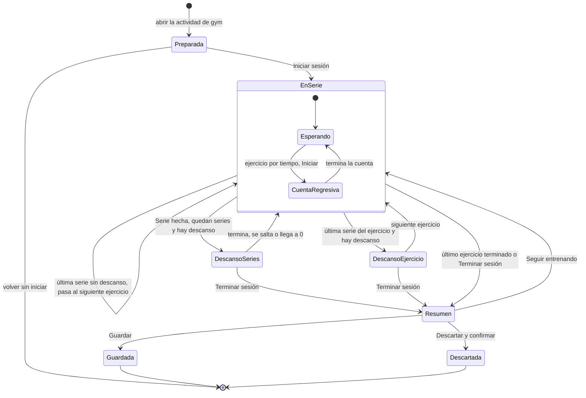

- **Cambiar el orden de los ejercicios** (CU-16 9b) no cambia de estado. Solo cambia cuál es el siguiente, y se puede hacer en `EnSerie` y en los dos descansos.
- **Lo que se guarda en la base de datos:** desde `EnSerie` hasta `Resumen`, la sesión existe como `EN_CURSO`. `Guardada` la pasa a `TERMINADA` y `Descartada` la borra con sus series.

### 1.2 Iniciar la sesión y confirmar una serie

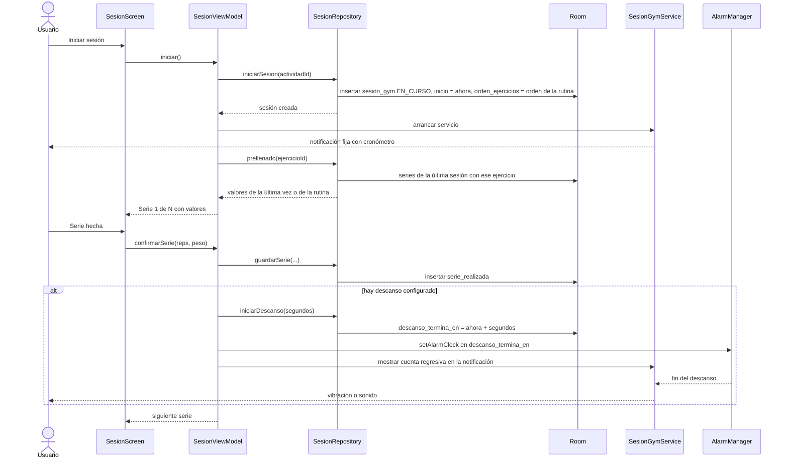

- **El ViewModel no lleva el tiempo con un contador.** El cronómetro siempre es `ahora − inicio`, y el descanso es `descanso_termina_en − ahora`. Así se ven bien aunque la app se haya detenido (RNF-07).
- **Ajustar el descanso** con ±15 s o saltarlo cambia `descanso_termina_en` y reemplaza la alarma, que tiene un código fijo.

### 1.3 Recuperar una sesión después de un cierre

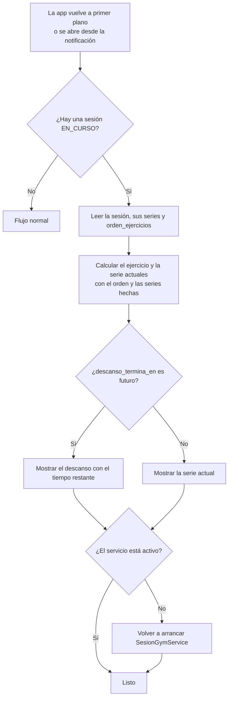

Esto cubre el caso de MIUI que cierra la app al deslizarla en recientes (arquitectura §4.6). No se pierde ninguna serie confirmada, porque cada una se guarda al momento.

### 1.4 Terminar y guardar

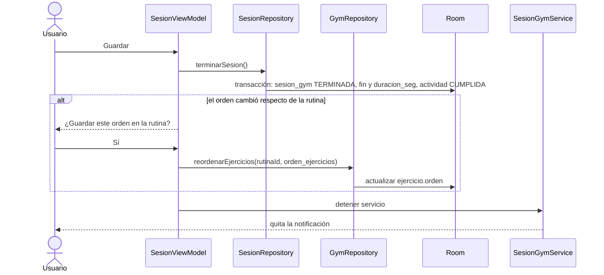

---

## 2. Respaldo y restauración

Cubre CU-21 a CU-24 y RF-44 a RF-47.

### 2.1 Registrar la carpeta de respaldos

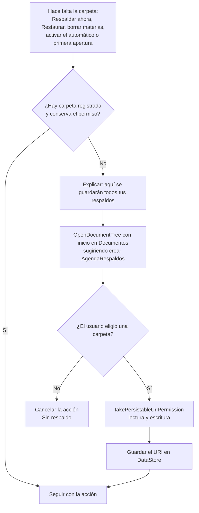

### 2.2 Respaldar ahora

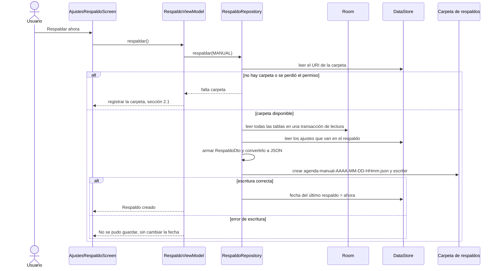

- **Una foto coherente:** la lectura de todas las tablas se hace en una sola transacción, para que el respaldo sea coherente aunque haya cambios al mismo tiempo.
- **Copia en otra ubicación (CU-21 1a):** sigue el mismo camino, pero en vez de crear el archivo en la carpeta abre `CreateDocument` y escribe en el URI que elige el usuario, por ejemplo en Google Drive.

**Formato del archivo**

```json
{
  "versionBaseDatos": 4,
  "versionApp": "1.0",
  "fecha": "2026-10-31T21:15:00Z",
  "ajustes": { "estaturaCm": 175, "avisos": { "…": "…" } },
  "materias": [ { "id": 1, "nombre": "Cálculo", "color": -11567956 } ],
  "clases": [ "…" ],
  "actividades": [ "…" ],
  "rutinas": [ "…" ],
  "ejercicios": [ "…" ],
  "diasGym": [ "…" ],
  "sesiones": [ "…" ],
  "series": [ "…" ],
  "registrosPeso": [ "…" ]
}
```

### 2.3 Restaurar un respaldo

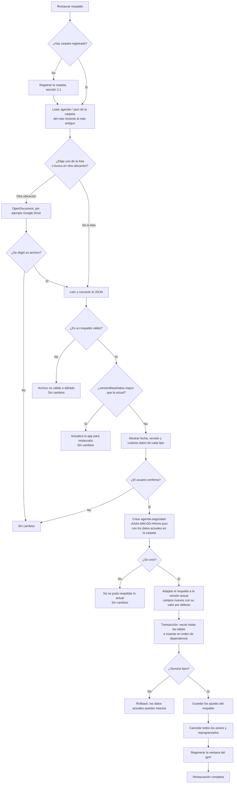

- **Respaldo de seguridad:** siempre va a la carpeta de respaldos, que a esta altura ya está registrada. Se conservan los últimos 5 de seguridad.
- **Orden de inserción:** primero los padres y después los hijos, para respetar las claves foráneas. El orden es `materia`, `clase`, `rutina`, `ejercicio`, `dia_gym`, `actividad`, `sesion_gym`, `serie_realizada` y `registro_peso`.
- **Identificadores:** se conservan los `id` del archivo, para que las relaciones sigan apuntando a lo mismo.

### 2.4 Respaldo automático

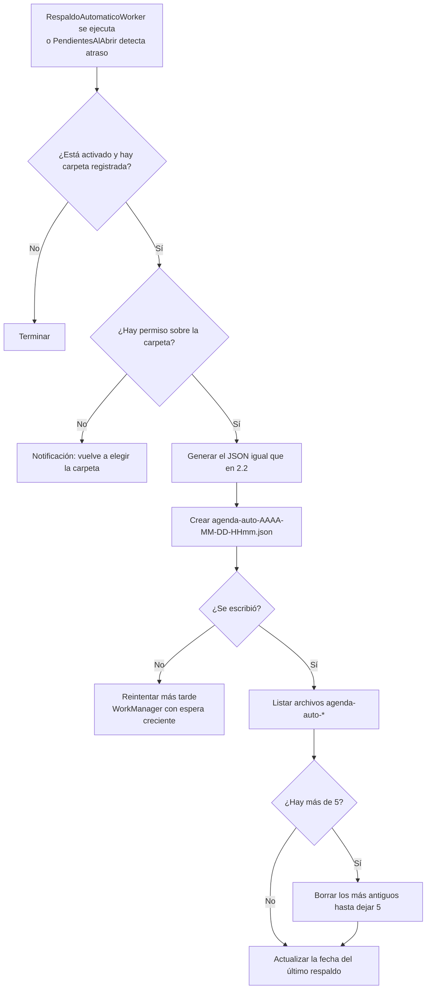

- **Nombre de los archivos:** el prefijo `agenda-auto-` distingue los automáticos de los manuales (`agenda-manual-`) y los de seguridad (`agenda-seguridad-`). Al rotar solo se borran los automáticos (CU-24 4a).
- **El worker** es periódico, con la frecuencia elegida, y no pide condiciones de red ni de carga.

---

## 3. Programación de avisos

Cubre CU-19 y CU-20, RF-38 a RF-43 y RNF-10.

### 3.1 Cuándo suena cada aviso

| Tipo de aviso | Hora en que suena | Tipo de alarma | Se omite si |
|---|---|---|---|
| Actividad con hora | `fecha + hora − aviso_minutos_antes` | `setAlarmClock` | Está cumplida, no tiene aviso o el tipo está desactivado. |
| Actividad sin hora | `fecha` a la hora fija de los ajustes | `setAlarmClock` | Igual que la anterior. |
| Día anterior | `fecha − 1 día` a la hora configurada | `setAlarmClock` | No es examen ni simulacro, está cumplida o está desactivado. |
| Gym | `fecha + hora − minutos de gym` | `setAlarmClock` | Está cumplida, saltada o desactivada. |
| Fin de descanso | `descanso_termina_en` | `setAlarmClock` | La sesión terminó o el descanso se saltó. |
| Clase | Próxima fecha con ese `dia_semana`, `hora_inicio − minutos de clase` | `setAlarmClock` | Está desactivado (por defecto). |
| Resumen del día | Cada día a la hora configurada | `setAlarmClock` | No hay actividades ni tareas atrasadas, o está desactivado. |

Con "Avisos con prioridad de alarma" desactivado, todos usan `setExactAndAllowWhileIdle` y pueden retrasarse en reposo ([arquitectura §4.2](03-arquitectura.md#42-avisos)).

- **Ventana de 7 días:** solo se programan los avisos de los próximos 7 días, para no tener cientos de alarmas activas. La ventana avanza cada día con `MantenimientoDiarioWorker` y con `PendientesAlAbrir`.
- **Código de alarma:** `id × 10 + tipo de aviso`, con el tipo como un dígito del 0 al 5. El mismo aviso siempre tiene el mismo código, así que volver a programarlo reemplaza al anterior en lugar de duplicarlo.
- **Avisos en el pasado:** si la hora calculada ya pasó, no se programa.

### 3.2 Programar al guardar una actividad

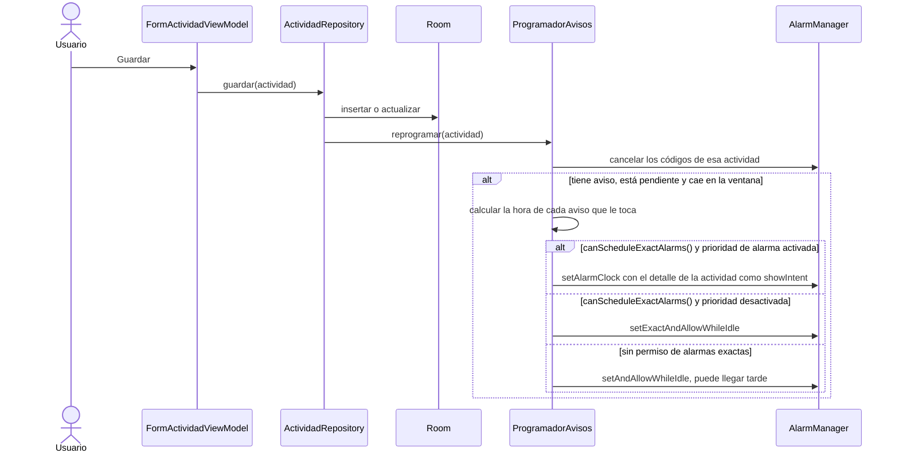

Lo mismo pasa al marcar o desmarcar (CU-08), al reprogramar una atrasada (CU-09), al mover o saltar una sesión (CU-15) y al borrar, que solo cancela.

### 3.3 Cuando suena una alarma

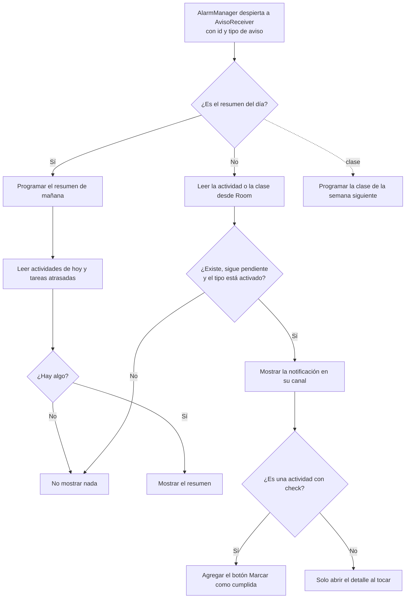

El receptor vuelve a leer la base de datos antes de mostrar el aviso. Si la actividad se marcó después de programar la alarma, no se muestra nada (CU-20 2a).

### 3.4 Marcar desde la notificación

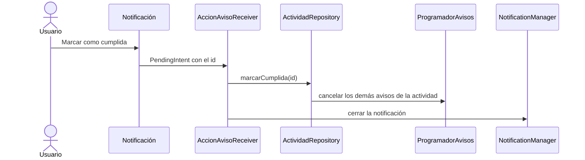

El receptor usa `goAsync()` para terminar la escritura en la base de datos sin abrir la app.

### 3.5 Reinicio del celular y cambios de hora

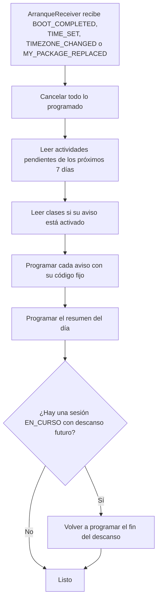

En MIUI, `BOOT_COMPLETED` solo llega si está activado el inicio automático. Si no lo está, este mismo proceso lo hace `PendientesAlAbrir` la próxima vez que se abra la app (sección 6).

---

## 4. Estados de una actividad

Cubre RF-13, RF-14, RF-15, RF-24 y RF-31. En la base de datos solo se guardan `PENDIENTE`, `CUMPLIDA` y `SALTADA` ([modelo de datos §2.2](02-modelo-de-datos.md#actividad)). Los estados de fondo gris se calculan al consultar, comparando la fecha con hoy.

### 4.1 Tarea, charla, simulacro y examen

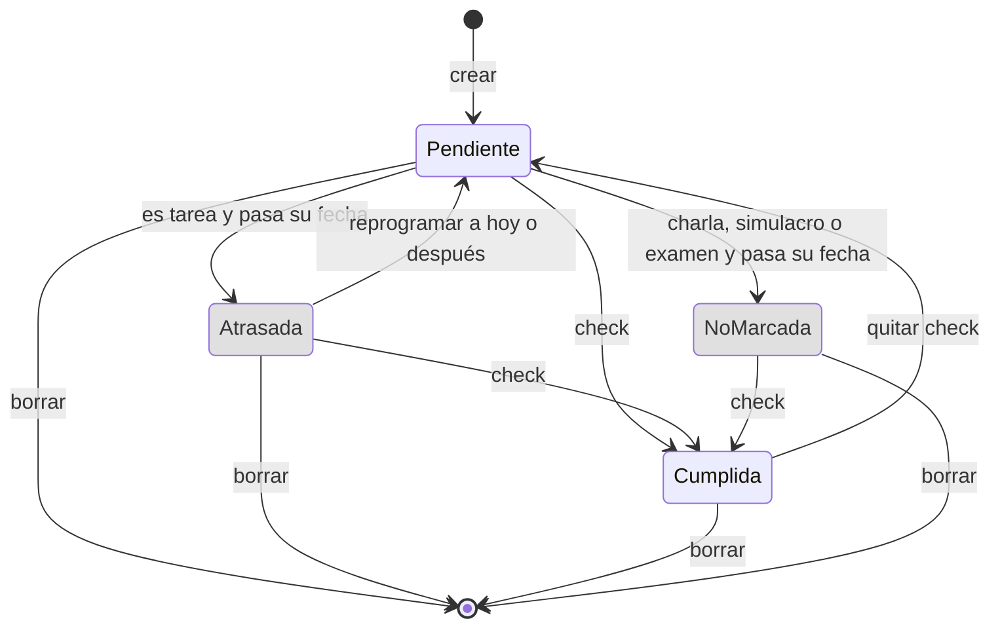

- **Atrasada:** aparece en la sección destacada del módulo de hoy, con sus días de atraso (RF-14).
- **No marcada:** se queda en su fecha y no pasa a hoy (RF-15).
- **Con check o sin él:** en ambos casos la actividad se puede editar, y al cambiar su fecha vuelve a evaluarse.

### 4.2 Actividad de gym

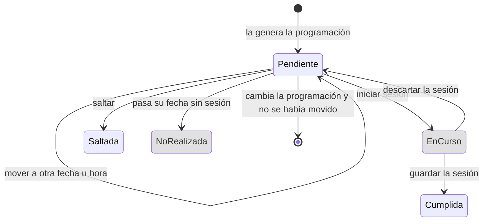

- **En curso:** la actividad sigue `PENDIENTE` y la sesión está `EN_CURSO`.
- **Cumplida:** se muestra como "Hecha · 52 min".
- **Saltada:** no cuenta como planificada en las estadísticas.
- **No realizada:** sí cuenta como planificada, pero no como hecha.
- **Al cambiar la programación** (CU-14), solo se borran las pendientes futuras que no se movieron.

---

## 5. Generación de las actividades de gym

Cubre CU-14, CU-15 y RF-23.

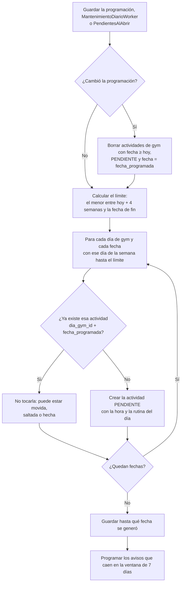

- **Sin duplicados:** el índice único `(dia_gym_id, fecha_programada)` evita duplicar actividades aunque la generación corra dos veces.
- **Todo en una transacción:** la generación se hace en una sola transacción, para que el módulo del día no muestre la semana a medias.

---

## 6. Comprobación al abrir

Cubre RNF-07 y RNF-11. La ejecuta `PendientesAlAbrir` cada vez que la app pasa a primer plano. Recupera lo que MIUI pudo haber impedido en segundo plano.

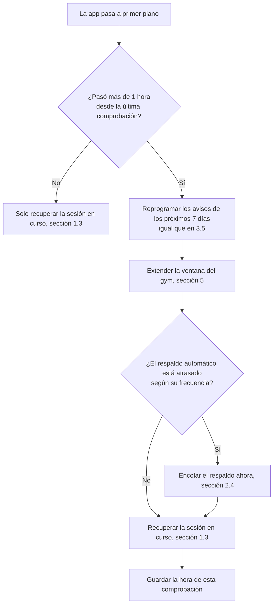

- **Límite de una vez por hora:** evita repetir todo el trabajo cada vez que se vuelve a la app.
- **Seguro de repetir:** todos los pasos dan el mismo resultado aunque se ejecuten varias veces, gracias a los códigos fijos de alarma y al índice único del gym.
