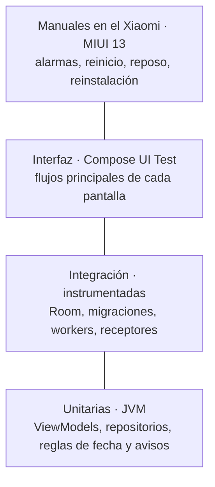

# Plan de pruebas

Estado: en revisión · Base: [Requerimientos v2.1](00-requerimientos.md), [Casos de uso](01-casos-de-uso.md), [Arquitectura](03-arquitectura.md), [Diagramas de comportamiento](05-diagramas-de-comportamiento.md)

---

## 1. Estrategia

**Qué se quiere asegurar.** La app es de uso diario y guarda datos que no están en ningún otro lugar. Por eso las pruebas ponen el foco en tres riesgos, en este orden:

1. **Perder datos:** al migrar la base de datos, al borrar en cascada, al restaurar un respaldo o al reinstalar (RNF-04, RNF-05).
2. **Avisos que no llegan o llegan dos veces:** en reposo, tras reiniciar o en MIUI (RNF-10, RNF-11).
3. **Reglas de fecha mal calculadas:** tareas atrasadas, semanas, generación del gym e IMC.

**Pirámide de pruebas.** La mayoría son unitarias, rápidas y sin dispositivo. Lo que depende de Android se prueba con pruebas instrumentadas, y lo que depende de MIUI, a mano en el Xiaomi.



**Cómo se hace en cada incremento.** Cada incremento pasa por diseño, código y pruebas (requerimientos §7):

1. Las pruebas unitarias de una regla se escriben junto con el código de esa regla.
2. Antes de cerrar el incremento se ejecutan **todas** las pruebas automáticas, también las de incrementos anteriores, como prueba de regresión.
3. Se hacen las pruebas manuales del incremento en el Xiaomi y la lista de humo (sección 3.7).
4. Se prueba la **actualización**: con el APK `release` del incremento anterior instalado y con datos, se instala el nuevo encima, sin desinstalar, y se comprueba que no se perdió nada ([arquitectura §5.3](03-arquitectura.md#53-firma-versiones-e-instalación)).

**El tiempo se controla en las pruebas.** Todas las clases reciben un `Clock` ([arquitectura §2](03-arquitectura.md#2-capas-mvvm)). Las pruebas lo fijan en el **viernes 30 de octubre de 2026, 10:00**, salvo que el caso diga otra cosa. Así "hoy", "ayer" y "la semana" son siempre los mismos.

**Datos de prueba.** Un conjunto fijo, `DatosDePrueba.kt`, que comparten las pruebas unitarias y las instrumentadas:

| Dato | Contenido |
|---|---|
| Materias | Cálculo (azul), Física (verde), Inglés (naranja) |
| Clases | Cálculo lunes, miércoles y viernes 07:00–09:00; Física martes 09:00–11:00 |
| Actividades | Una tarea atrasada 3 días, un examen ayer sin check, una tarea hoy sin hora, un examen el 6 de noviembre a las 10:30 |
| Rutinas | Pierna (4 ejercicios, uno por tiempo) y Torso (3 ejercicios) |
| Programación | Lunes y viernes 18:00 Pierna, miércoles 18:00 Torso |
| Peso | Estatura 175 cm y tres registros semanales |

---

## 2. Tipos de prueba y herramientas

| Tipo | Qué cubre | Dónde corre | Herramientas |
|---|---|---|---|
| **Unitaria** | ViewModels, repositorios con DAOs falsos, reglas de fecha, cálculo de avisos, generación del gym, IMC, conversión del JSON del respaldo. | JVM (`app/src/test`) | JUnit 4, `kotlinx-coroutines-test` (`runTest`), Turbine para `Flow`, `Clock.fixed` |
| **Integración** | DAOs y consultas reales, claves foráneas y cascadas, transacciones, migraciones, workers y receptores. | Emulador o celular (`app/src/androidTest`) | Room en memoria, `MigrationTestHelper`, `work-testing`, `AndroidJUnit4` |
| **Interfaz** | Flujos de pantalla: marcar un check, crear una actividad, reordenar ejercicios, la sesión de gym. | Emulador o celular | Compose UI Test (`createAndroidComposeRule`) |
| **Manual** | Lo que depende del sistema: alarmas reales, reposo, reinicio, MIUI, selector de archivos, Google Drive, reinstalación. | Xiaomi con Android 12 y MIUI 13 | `adb` y lista de pasos (sección 3) |

**Dobles de prueba.** Las clases que tocan Android tienen una interfaz y una versión falsa para las pruebas unitarias:

| Interfaz | Versión real | Versión falsa |
|---|---|---|
| `ProgramadorAvisos` | Usa `AlarmManager` | Guarda en una lista qué se programó y para cuándo |
| `AlmacenRespaldos` | Usa `DocumentFile` sobre la carpeta | Usa un directorio temporal |
| `EstadoSistema` | Lee permisos y batería | Devuelve valores fijados por la prueba |
| `Clock` | `Clock.systemDefaultZone()` | `Clock.fixed(...)` |
| `DataStore<Preferences>` | DataStore en un archivo | `DataStoreEnMemoria`: en Windows, el DataStore real no logra renombrar su archivo temporal dentro de las pruebas de JVM (`Unable to rename …preferences_pb.tmp`). El real se prueba en el celular. |
| `Notificador` | Usa `NotificationManager` | Guarda en una lista qué se notificó |

**Comandos útiles en el Xiaomi**

| Para | Comando |
|---|---|
| Ver las alarmas programadas por la app | `adb shell dumpsys alarm \| grep -A3 com.calendar.tasktodo` |
| Forzar el reposo profundo (Doze) | `adb shell dumpsys battery unplug` y después `adb shell dumpsys deviceidle force-idle` |
| Salir del reposo | `adb shell dumpsys deviceidle unforce` y `adb shell dumpsys battery reset` |
| Ver los trabajos de WorkManager | `adb shell dumpsys jobscheduler \| grep -A5 com.calendar.tasktodo` |
| Matar el proceso como lo hace el sistema | `adb shell am kill com.calendar.tasktodo` |

**Preparar el Xiaomi para las pruebas instrumentadas.** MIUI bloquea por defecto que la app de pruebas abra su ventana desde segundo plano (en el registro aparece `MIUILOG- Permission Denied Activity`), y la prueba de interfaz se queda esperando sin fallar. Hace falta, una sola vez:

1. En Opciones de desarrollador: "Depuración USB", "Instalar vía USB" y "Depuración USB (ajustes de seguridad)".
2. Instalar las apps con `adb install -r`, aceptando el aviso de MIUI en el celular, en lugar de `connectedDebugAndroidTest`, que las desinstala al terminar y con ello borra el permiso:
   - `adb install -r app/build/outputs/apk/debug/app-debug.apk`
   - `adb install -r app/build/outputs/apk/androidTest/debug/app-debug-androidTest.apk`
3. En Ajustes → Aplicaciones → TaskToDo (dev) → Otros permisos, permitir **"Mostrar ventanas emergentes mientras se ejecuta en segundo plano"**.
4. Ejecutar: `adb shell am instrument -w -r com.calendar.tasktodo.debug.test/androidx.test.runner.AndroidJUnitRunner`.

Al reinstalar con `adb install -r` el permiso se conserva. Solo lo necesita la variante de desarrollo.

**Cobertura.** Se mide con la cobertura integrada de AGP (`enableUnitTestCoverage = true` en el tipo `debug`). La meta es **80 % o más** en los paquetes `data.repositorio` y `ui.*` (ViewModels). No se pone meta en las pantallas Compose ni en `sistema`, que se cubren con pruebas de interfaz y manuales.

**Nombres de las pruebas.** En español, describiendo el comportamiento:

```kotlin
@Test
fun `una tarea sin check con fecha pasada aparece como atrasada`() = runTest { … }
```

---

## 3. Casos de prueba por incremento

Cada caso tiene un identificador `CP-<incremento>.<número>`, su tipo (U unitaria, I integración, UI interfaz, M manual) y los requisitos que verifica. La [matriz de trazabilidad](07-matriz-de-trazabilidad.md) los cruza con los RF.

### 3.1 Incremento 1 · Materias, horario y módulo del día

| ID | Tipo | Caso | Resultado esperado | Verifica |
|---|---|---|---|---|
| CP-1.01 | UI | Abrir la app sin materias. | Se muestra la bienvenida. | RF-01, CU-01 |
| CP-1.02 | UI | Abrir la app con al menos una materia. | Se muestra el módulo del día actual. | RF-18 |
| CP-1.03 | U | Guardar una materia con nombre vacío, y otra con un nombre que ya existe con otras mayúsculas ("cálculo"). | No se guarda ninguna; cada una muestra su error. | RF-02, CU-02 5a, 5b |
| CP-1.04 | I | Eliminar una materia con 3 clases y 2 actividades. | Se borran las 3 clases; las 2 actividades quedan con `materia_id` nulo. | RF-03 |
| CP-1.05 | I | Eliminar todas las materias. | Las tablas `materia` y `clase` quedan vacías, y las actividades se conservan sin materia. | RF-04, CU-03 |
| CP-1.06 | U | Guardar una clase con hora de fin igual o anterior a la de inicio. | No se guarda y se muestra el error. | RF-05, CU-04 3a |
| CP-1.07 | U | Guardar una clase que se cruza con otra el mismo día. | Se muestra la advertencia; solo se guarda al confirmar. | CU-04 3b |
| CP-1.08 | U | Consultar el módulo del lunes 2, el miércoles 4 y el viernes 6 de noviembre. | Cálculo aparece los tres días, sin haberse guardado por fecha. | RF-08 |
| CP-1.09 | U | Consultar el horario semanal. | Clases de lunes a domingo, ordenadas por hora. | RF-06, CU-05 |
| CP-1.10 | UI | En el módulo del día, tocar ‹, › y elegir una fecha en el calendario. | Muestra el día anterior, el siguiente y el elegido; el botón "Hoy" vuelve al actual. | RF-19 |
| CP-1.11 | U | Módulo del viernes 30 de octubre. | Clases ordenadas por hora, con el nombre y el color de su materia. | RF-17 |
| CP-1.12 | I | Migración: versión 1 creada desde cero con `exportSchema`. | El esquema exportado existe en `app/schemas/` y coincide. | RNF-04 |
| CP-1.13 | M | Instalar en el Xiaomi desde Android Studio. | La app se instala y abre; el tema no usa color dinámico. | RNF-01 |
| CP-1.14 | U | Editar el horario de una clase y después eliminarla. | El cambio se ve en todas las semanas; al eliminarla, deja de aparecer en todas. | RF-07, CU-04 1b, 1c |
| CP-1.15 | M | Generar el APK `release` firmado con `agenda-release.jks`, instalarlo y cargar materias. Después subir `versionCode`, generar otro APK e instalarlo encima con `adb install -r`. | Se instala sin pedir desinstalar y las materias siguen ahí. | RNF-04 |
| CP-1.16 | M | Instalar la variante `debug` desde Android Studio con la `release` ya instalada. | Aparecen dos apps, "TaskToDo" y "TaskToDo (dev)", cada una con sus propios datos. | RNF-04 |
| CP-1.17 | M | Intentar instalar un APK firmado con la clave de depuración encima de la `release`. | Android lo rechaza (`INSTALL_FAILED_UPDATE_INCOMPATIBLE`) y los datos no se tocan. Confirma por qué no se debe aceptar desinstalar. | RNF-04 |
| CP-1.18 | M | Intentar instalar un APK con un `versionCode` menor que el instalado. | Android lo rechaza (`INSTALL_FAILED_VERSION_DOWNGRADE`) y los datos no se tocan. | RNF-04 |
| CP-1.19 | M | Abrir el APK `release` en el Xiaomi y recorrer Hoy, Calendario, Materias y Ajustes. | La app abre y ninguna pantalla se cierra. Detecta fallos que solo aparecen en `release`, como el de R8 del incremento 1. | RNF-01, RNF-04 |

### 3.2 Incremento 2 · Actividades, atrasadas y avisos

**Actividades y módulo del día**

| ID | Tipo | Caso | Resultado esperado | Verifica |
|---|---|---|---|---|
| CP-2.01 | U | Crear una actividad sin título o sin fecha. | No se guarda e indica qué falta. | RF-09, CU-06 3a |
| CP-2.02 | UI | Tocar "+" en el módulo del 6 de noviembre. | El formulario abre con la fecha 6 de noviembre puesta. | RF-21 |
| CP-2.03 | U | Editar la fecha y la hora de una actividad con aviso. | Se guarda y el programador falso registra la cancelación del aviso viejo y el nuevo aviso. | RF-11 |
| CP-2.04 | U | Eliminar una actividad con aviso. | Se borra y su aviso se cancela. | RF-12 |
| CP-2.05 | U | Filtrar por tipo Examen y por materia Física, juntos y por separado. | Solo aparecen las que cumplen todos los filtros activos. | RF-10, CU-07 |
| CP-2.06 | UI | Tocar el check de una actividad en el módulo del día. | Queda cumplida con un solo toque, tachada; un segundo toque la desmarca. | RF-13, RF-20, RNF-08 |
| CP-2.07 | U | Tarea con fecha 27 de octubre sin check, hoy 30. | Aparece en "Atrasadas" con "hace 3 días". | RF-14 |
| CP-2.08 | U | Examen del 29 de octubre sin check, hoy 30. | No aparece en "Atrasadas"; en el módulo del 29 se ve como "No marcado". | RF-15 |
| CP-2.09 | U | Reprogramar una tarea atrasada a ayer, a hoy y al 3 de noviembre. | Ayer no se permite; con hoy o el 3 sale de atrasadas. | RF-14, CU-09 |
| CP-2.10 | U | Detalle de una clase de Física con 7 actividades futuras de Física. | Muestra las 5 próximas, ordenadas por fecha. | RF-16 |
| CP-2.11 | U | Módulo de un día con actividades con hora y sin hora. | Las que tienen hora van en orden; las sin hora, en su grupo aparte. | RF-17 |
| CP-2.12 | I | Migración de la versión 1 a la 2 con materias y clases guardadas. | Los datos siguen iguales y existe la tabla `actividad`. | RNF-04 |
| CP-2.13 | UI | Tocar una actividad en el módulo del día. | Se abre su detalle. | RF-22 |

**Avisos**

| ID | Tipo | Caso | Resultado esperado | Verifica |
|---|---|---|---|---|
| CP-2.20 | U | Actividad el 6 de noviembre 10:30 con aviso 30 min antes. | Se programa para el 6 de noviembre a las 10:00. | RF-38 |
| CP-2.21 | U | Actividad sin hora con aviso; hora fija de los ajustes 08:00. | Se programa a las 08:00 de su fecha. | RF-38 |
| CP-2.22 | U | Examen el 6 de noviembre; aviso del día anterior a las 20:00. | Se programa también para el 5 de noviembre a las 20:00. | RF-39 |
| CP-2.23 | U | Actividad a 10 días de hoy con aviso. | No se programa todavía (fuera de la ventana de 7 días); se programa cuando entra en ella. | Diagramas §3.1 |
| CP-2.24 | U | Reprogramar dos veces la misma actividad. | Siempre se usa el mismo código de alarma; solo queda una alarma activa. | Diagramas §3.1 |
| CP-2.25 | U | Marcar como cumplida una actividad con aviso futuro. | Su aviso se cancela; al desmarcarla, se vuelve a programar. | RF-43, CU-08 1b |
| CP-2.26 | U | Avisos de clase: desactivados por defecto; al activarlos con 10 min. | Por defecto no se programa ninguno; al activarlos, uno por clase de la ventana, 10 min antes. | RF-41 |
| CP-2.27 | U | Resumen del día con 2 actividades y 1 atrasada; y sin nada. | El primero muestra las 3; el segundo no envía nada. | RF-42, CU-20 1e |
| CP-2.28 | U | Prioridad de alarma activada y desactivada. | Activada: todos los avisos, incluidos clases y resumen, con `setAlarmClock`. Desactivada: todos con `setExactAndAllowWhileIdle`, y la pantalla pide confirmar con la advertencia de retraso. | RNF-10 |
| CP-2.29 | U | `canScheduleExactAlarms()` falso. | Se usa `setAndAllowWhileIdle` y la guía muestra el permiso pendiente. | CU-19 1b |
| CP-2.30 | I | `AvisoReceiver` para una actividad que se marcó después de programar. | No muestra la notificación. | RF-43, CU-20 2a |
| CP-2.31 | I | `AccionAvisoReceiver` con el botón "Marcar como cumplida". | La actividad queda `CUMPLIDA` y la notificación se cierra, sin abrir la app. | RF-43, CU-08 1a |
| CP-2.32 | M | En el Xiaomi, con el celular bloqueado y en Doze forzado, un aviso de cada tipo: actividad con hora, actividad sin hora, día anterior, clase y resumen. | Cada uno llega con ±1 minuto de su hora, con el ícono de alarma visible antes. | RNF-10, RNF-11 |
| CP-2.33 | M | Programar un aviso, reiniciar el Xiaomi con inicio automático activado. | El aviso llega a su hora sin abrir la app. | RF-43 |
| CP-2.34 | M | Igual, pero con inicio automático desactivado y abriendo la app tras reiniciar. | Al abrir, la comprobación reprograma el aviso y llega a su hora. | RNF-11, Diagramas §6 |
| CP-2.35 | M | Cerrar la app deslizándola en recientes, con un aviso en 5 minutos. | El aviso llega. Si no llega, la guía de MIUI debe indicar qué falta. | RNF-11 |
| CP-2.36 | M | Guía de MIUI con batería "Inteligente" y luego "Sin restricciones". | Primero marca la batería como pendiente; después, lista. Cada botón abre el ajuste correcto. | RNF-11, CU-19 1c |
| CP-2.37 | M | Cambiar la hora del celular una hora adelante con avisos programados. | Los avisos se reprograman (`TIME_SET`) y suenan a su hora real. | CU-20 1f |
| CP-2.38 | M | Tres actividades con aviso a la misma hora, y otras dos con 2 minutos de diferencia, en Doze forzado. | Las cinco llegan con ±1 minuto de su hora; ninguna se retrasa por la cuota de Doze. | RNF-10 |

### 3.3 Incremento 3 · Respaldo y restauración

| ID | Tipo | Caso | Resultado esperado | Verifica |
|---|---|---|---|---|
| CP-3.01 | U | Convertir todos los datos de prueba a JSON y volver a leerlos. | Los datos leídos son idénticos a los originales, ida y vuelta. | RNF-06 |
| CP-3.02 | U | El JSON generado. | Incluye `versionBaseDatos`, `versionApp`, `fecha`, los ajustes y todas las tablas. | RNF-06 |
| CP-3.03 | UI | "Respaldar ahora" sin carpeta registrada. | Explica para qué es la carpeta y abre el selector; al cancelar no se crea nada. | RF-47, CU-21 2a |
| CP-3.04 | U | "Respaldar ahora" con carpeta (almacén falso). | Crea `agenda-manual-…json` y actualiza la fecha del último respaldo. | RF-44 |
| CP-3.05 | U | Falla la escritura del respaldo. | Muestra el error y no cambia la fecha del último respaldo. | CU-21 4a |
| CP-3.06 | U | Restaurar: lista de la carpeta con archivos manuales, automáticos y de seguridad, y archivos ajenos. | Muestra solo los `agenda-*.json`, del más reciente al más antiguo, con su tipo. | RF-45, CU-22 |
| CP-3.07 | U | Restaurar un archivo dañado, y otro con `versionBaseDatos` mayor que la actual. | Ambos se rechazan con su mensaje y no cambia nada. | CU-22 4a, 4b |
| CP-3.08 | I | Restaurar un respaldo válido sobre datos distintos. | Se crea `agenda-seguridad-…json` antes; después los datos son exactamente los del archivo. | RF-45 |
| CP-3.09 | I | Forzar un error a mitad de la restauración. | La transacción se deshace; los datos de antes siguen intactos. | CU-22 8a |
| CP-3.10 | I | Restaurar un respaldo de la versión 2 en la versión 4. | Se restaura; las tablas del gym quedan vacías y los campos nuevos con su valor por defecto. | RNF-06 |
| CP-3.11 | I | `RespaldoAutomaticoWorker` con 5 automáticos, 2 manuales y 1 de seguridad. | Crea uno nuevo, borra el automático más antiguo y deja los manuales y el de seguridad. | RF-46, CU-24 4a |
| CP-3.12 | U | Último respaldo hace 9 días. | Ajustes muestra la advertencia "Han pasado 9 días sin respaldo". | RF-47 |
| CP-3.13 | U | Respaldo automático semanal atrasado al abrir la app. | La comprobación al abrir encola el respaldo. | CU-24 1b |
| CP-3.14 | U | Eliminar todas las materias (CU-03) ahora con respaldo. | Ofrece respaldar antes; si acepta, crea el respaldo y después borra. | RF-04 |
| CP-3.15 | M | Registrar `Documentos/AgendaRespaldos` y reiniciar el Xiaomi. | La carpeta sigue registrada y "Respaldar ahora" funciona sin volver a pedirla. | RF-47 |
| CP-3.16 | M | Intentar registrar la raíz del almacenamiento o Descargas. | El selector no lo permite y la app sugiere una subcarpeta. | CU-23 5b |
| CP-3.17 | M | "Guardar una copia en otra ubicación" en Google Drive y restaurarla con "Buscar en otra ubicación". | La copia aparece en Drive y se restaura bien. | RF-44, CU-22 2b |
| CP-3.18 | M | **Reinstalación completa:** respaldar, desinstalar, instalar, "Restaurar un respaldo" en la bienvenida y elegir la misma carpeta. | Aparecen los respaldos anteriores y, al restaurar, todos los datos vuelven, con avisos reprogramados. | RNF-04, RNF-05, CU-01 2a |

### 3.4 Incremento 4 · Semana y mes

| ID | Tipo | Caso | Resultado esperado | Verifica |
|---|---|---|---|---|
| CP-4.01 | U | Semana del 26 de octubre al 1 de noviembre. | Empieza el lunes 26; cada día con sus clases y actividades en orden. | RF-34 |
| CP-4.02 | U | Mes de noviembre de 2026. | 1 de noviembre en domingo; cada día con un punto por actividad, hasta tres; sin las clases. | RF-35 |
| CP-4.03 | UI | Tocar un día en el mes, luego "Ver semana", luego un día en la semana. | Mes → semana de ese día → módulo de ese día. | RF-36 |
| CP-4.04 | U | Día pasado con una tarea sin check; día pasado solo con gym no realizado; día futuro sin check. | La señal aparece solo en el primero. | RF-37 |
| CP-4.05 | U | Semana que cruza el cambio de mes y de año (28 de diciembre al 3 de enero). | Los 7 días son correctos. | RF-34 |

### 3.5 Incremento 5 · Gym

**Rutinas y ejercicios**

| ID | Tipo | Caso | Resultado esperado | Verifica |
|---|---|---|---|---|
| CP-5.01 | U | Crear una rutina sin nombre, o con un nombre repetido. | No se guarda e indica el motivo. | RF-25, CU-12 6a, 6b |
| CP-5.02 | U | Ejercicio por repeticiones sin repeticiones, y por tiempo sin duración. | No se guardan e indican qué falta. | RF-26, CU-13 5a |
| CP-5.03 | UI | "Guardar y agregar otro" tres veces. | Quedan 3 ejercicios en orden y el formulario vuelve vacío cada vez. | CU-13 4a |
| CP-5.04 | U | Duplicar el ejercicio 2 de 4. | La copia queda en la posición 3 y los demás se corren. | CU-13 2e |
| CP-5.05 | UI | Arrastrar el bloque 1 a la posición 3 en una rutina de 4. | Orden final 2, 3, 1, 4, guardado sin botón; "Deshacer" lo revierte. | RF-26, CU-13 2d |
| CP-5.06 | U | "Mover a la posición…" con 1, con N y con un valor fuera de rango. | Va a la posición indicada; el valor fuera de rango no se acepta. | CU-13 2d |
| CP-5.07 | I | Eliminar un ejercicio que tiene series en sesiones guardadas. | El ejercicio se borra; sus series quedan con `ejercicio_id` nulo y conservan su nombre. | CU-13 2c |
| CP-5.08 | I | Eliminar una rutina asignada a un día de gym. | No se permite (RESTRICT); se pide asignar otra antes. | CU-12 3b |
| CP-5.09 | I | Eliminar una rutina con una actividad futura movida. | Se borran sus actividades futuras pendientes, incluida la movida, y luego la rutina. | Modelo §3 |

**Programación**

| ID | Tipo | Caso | Resultado esperado | Verifica |
|---|---|---|---|---|
| CP-5.10 | U | Programar lunes, miércoles y viernes; hoy viernes 30 de octubre. | Se generan las actividades de hoy a 4 semanas, en esos días, con su hora y su rutina. | RF-23 |
| CP-5.11 | U | Generar dos veces seguidas. | No hay duplicados. | Diagramas §5 |
| CP-5.12 | U | Programación con fecha de fin el 15 de noviembre. | No hay actividades después del 15. | RF-23 |
| CP-5.13 | U | Mover el lunes 2 al martes 3 y después cambiar la hora de los lunes. | La del martes 3 se conserva; los demás lunes cambian de hora. | RF-24, CU-14 6a |
| CP-5.14 | U | Saltar la sesión del miércoles 4. | Queda `SALTADA`, su aviso se cancela y no cuenta como planificada. | RF-24, CU-15 2a |
| CP-5.15 | U | Solo se ofrecen rutinas con ejercicios al programar. | Una rutina vacía no aparece en la lista. | CU-14 4a |
| CP-5.16 | U | Aviso de gym 15 min antes de las 18:00. | Se programa a las 17:45 con el nombre de la rutina. | RF-40 |

**Sesión**

| ID | Tipo | Caso | Resultado esperado | Verifica |
|---|---|---|---|---|
| CP-5.20 | U | Iniciar sesión. | Se guarda `inicio`, `orden_ejercicios` igual al de la rutina, y estado `EN_CURSO`. | RF-27 |
| CP-5.21 | U | Prellenado de la serie 2 con una sesión anterior de 12 × 115 kg y la rutina en 12 × 120 kg. | Viene con 12 × 115 kg; sin sesión anterior, con 12 × 120 kg. | RF-28 |
| CP-5.22 | U | Confirmar la serie 2 de 4 con descanso de 90 s. | "Serie 2 de 4" pasa a descanso; `descanso_termina_en` es ahora + 90 s. | RF-28, RF-29 |
| CP-5.23 | U | Ajustar el descanso con +15 s, −15 s y saltar. | `descanso_termina_en` cambia en cada caso y la alarma se reemplaza. | RF-29 |
| CP-5.24 | U | Última serie con descanso del ejercicio de 60 s y de la rutina de 120 s; y sin ninguno. | Usa 60 s; sin ninguno, pasa directo al siguiente ejercicio. | RF-29, CU-16 9a |
| CP-5.25 | U | Ejercicio por tiempo de 45 s. | Cuenta regresiva de 45 s y pide confirmar al terminar. | RF-29 |
| CP-5.26 | U | Durante la sesión, "Hacer ahora" en el ejercicio 4 con el 2 a medias (1 de 4). | El 4 pasa a actual; el 2 vuelve a pendientes con 3 series y se puede mover. | RF-28, CU-16 9b |
| CP-5.27 | U | Arrastrar un pendiente a otra posición durante un descanso. | Cambia `orden_ejercicios` y el texto "Siguiente:" se actualiza. | CU-16 9b |
| CP-5.28 | U | Guardar una sesión con el orden cambiado, respondiendo sí y no. | Con sí, `ejercicio.orden` de la rutina cambia; con no, queda igual. | CU-16 11a |
| CP-5.29 | U | Guardar la sesión. | `TERMINADA`, con `fin` y `duracion_seg`, y la actividad `CUMPLIDA`. | RF-31 |
| CP-5.30 | U | Descartar la sesión. | Se borran la sesión y sus series; la actividad sigue `PENDIENTE`. | CU-16 10b |
| CP-5.31 | U | Actividad de gym de ayer sin sesión. | Se muestra "No realizada" y cuenta como planificada no hecha. | RF-31 |
| CP-5.32 | I | Migración de la versión 2 a la 3 con actividades guardadas. | Las actividades conservan sus datos y tienen las columnas nuevas en nulo. | RNF-04 |
| CP-5.33 | M | Sesión con la pantalla apagada y el Xiaomi en Doze forzado durante un descanso de 60 s. | Vibra a los 60 s (±2 s). La notificación muestra el cronómetro y el descanso. | RF-29, RF-30 |
| CP-5.34 | M | Sesión en curso: cerrar la app deslizándola en recientes y volver a abrir. | La sesión se retoma en el mismo ejercicio, serie y orden, con el cronómetro correcto. | RNF-07, Diagramas §1.3 |
| CP-5.35 | M | Sesión de 45 minutos con la app en segundo plano casi todo el tiempo. | La duración guardada es de 45 minutos (±1). | RNF-07 |
| CP-5.36 | M | Pantalla de sesión abierta 3 minutos sin tocarla. | La pantalla no se apaga. | Diseño §3.11 |
| CP-5.37 | UI | Tocar una actividad de gym en el módulo del día. | Se abre su rutina con el botón "Iniciar sesión". | RF-22 |

### 3.6 Incremento 6 · Peso, IMC y estadísticas

| ID | Tipo | Caso | Resultado esperado | Verifica |
|---|---|---|---|---|
| CP-6.01 | U | Peso 72.5 kg con estatura 175 cm. | IMC 23.7, categoría Normal. | RF-32 |
| CP-6.02 | U | Límites de categoría: IMC 18.49, 18.5, 24.99, 25, 29.99 y 30. | Bajo peso, Normal, Normal, Sobrepeso, Sobrepeso y Obesidad. | RF-32 |
| CP-6.03 | U | Cambiar la estatura a 180 cm. | El IMC de todos los registros se recalcula. | CU-17 2a |
| CP-6.04 | U | Registros sin estatura guardada. | Se muestran sin IMC y se pide la estatura. | CU-17 1a |
| CP-6.05 | U | Registro con peso 0 o vacío, y otro en una fecha que ya tiene registro. | El primero no se guarda; el segundo ofrece reemplazar. | CU-17 6a, 6b |
| CP-6.06 | U | Minutos por semana con sesiones de 50, 40 y 60 min en una semana. | La semana suma 150 min. | RF-33 |
| CP-6.07 | U | Sesiones hechas frente a planificadas con 3 hechas, 1 no realizada y 1 saltada. | 3 de 4 (75 %); la saltada no cuenta. | RF-33 |
| CP-6.08 | U | Progreso de Sentadilla en 3 sesiones. | Peso máximo y volumen (repeticiones × peso) correctos por sesión. | RF-33 |
| CP-6.09 | U | Cambiar el periodo entre semana, mes, 3 meses y todo. | Cada gráfica usa solo los datos del periodo. | RF-33 |
| CP-6.10 | U | Periodo sin datos. | Cada gráfica muestra "Sin datos en este periodo". | CU-18 2a |
| CP-6.11 | I | Migración de la versión 3 a la 4 con todos los datos de prueba. | Todo se conserva y existe `registro_peso`. | RNF-04 |

### 3.7 Lista de humo en el Xiaomi

Se hace al cerrar cada incremento, después de instalar sobre la versión anterior, y toma unos 10 minutos. Solo se revisan los puntos ya implementados.

1. El APK `release` nuevo se instaló encima del anterior sin pedir desinstalar, y la app abre en el módulo de hoy con los datos de antes de actualizar. Las pruebas automáticas corren sobre la variante de desarrollo, así que este paso es el único que prueba la app real.
2. Crear una actividad con aviso para dentro de 3 minutos, bloquear el celular y esperar a que suene.
3. Marcar una actividad desde la notificación.
4. Revisar que las tareas atrasadas aparecen arriba.
5. "Respaldar ahora" y comprobar que el archivo está en la carpeta.
6. Navegar semana → mes → día.
7. Hacer dos series de una sesión de gym con un descanso, y salir y volver a la app en medio.
8. Abrir la guía de MIUI y comprobar que todos los puntos están en verde.

---

## 4. Criterios de aceptación

**Un incremento está terminado cuando:**

1. **Todas las pruebas automáticas pasan:** unitarias, de integración y de interfaz, incluidas las de incrementos anteriores.
2. **Las pruebas manuales del incremento pasan** en el Xiaomi con Android 12 y MIUI 13, con los ajustes de la guía de MIUI aplicados.
3. **La lista de humo pasa** después de instalar sobre la versión anterior, sin perder datos.
4. **La cobertura de los repositorios y ViewModels es de 80 % o más.**
5. **No queda ningún defecto bloqueante ni alto abierto** (ver abajo). Los medios y bajos quedan anotados para un incremento siguiente.
6. **Los RF del incremento** están marcados como verificados en la [matriz de trazabilidad](07-matriz-de-trazabilidad.md).

**Severidad de los defectos**

| Severidad | Qué significa | Ejemplo |
|---|---|---|
| Bloqueante | Se pierden o corrompen datos, o la app no abre. | Una migración borra actividades. |
| Alta | Un RF no funciona o un aviso no llega. | Un examen no avisa el día anterior. |
| Media | Funciona, pero con un error visible o con un rodeo. | El contador de días de atraso marca uno de más. |
| Baja | Detalle visual o de texto. | Un texto se corta en pantallas chicas. |

**Criterios de calidad que aplican siempre**

| Criterio | Medida | Origen |
|---|---|---|
| Un toque para marcar y para confirmar una serie | Prueba de interfaz: un solo `performClick`. | RNF-08 |
| Avisos puntuales | Todos los avisos llegan con ±1 minuto de su hora en las pruebas manuales, incluso en Doze y con varios avisos seguidos (CP-2.32, CP-2.38). Si uno se sale del margen, es un defecto alto. | RNF-10 |
| Descanso puntual | El fin de descanso vibra con ±2 segundos de diferencia. | RF-29 |
| Ninguna pérdida de datos | La prueba de actualización (APK `release` instalado encima, sin desinstalar) y la de reinstalación conservan el 100 % de los datos. | RNF-04, RNF-05 |
| Sin internet | La app funciona en modo avión, salvo la copia a Google Drive. | RNF-03 |
| Sin cuentas ni red | El manifiesto final no declara `INTERNET` ni pide iniciar sesión. | RNF-02 |
| Capas MVVM | En la revisión de código, ningún ViewModel importa Room ni `Context`, y ninguna pantalla llama a un repositorio. | RNF-09 |
